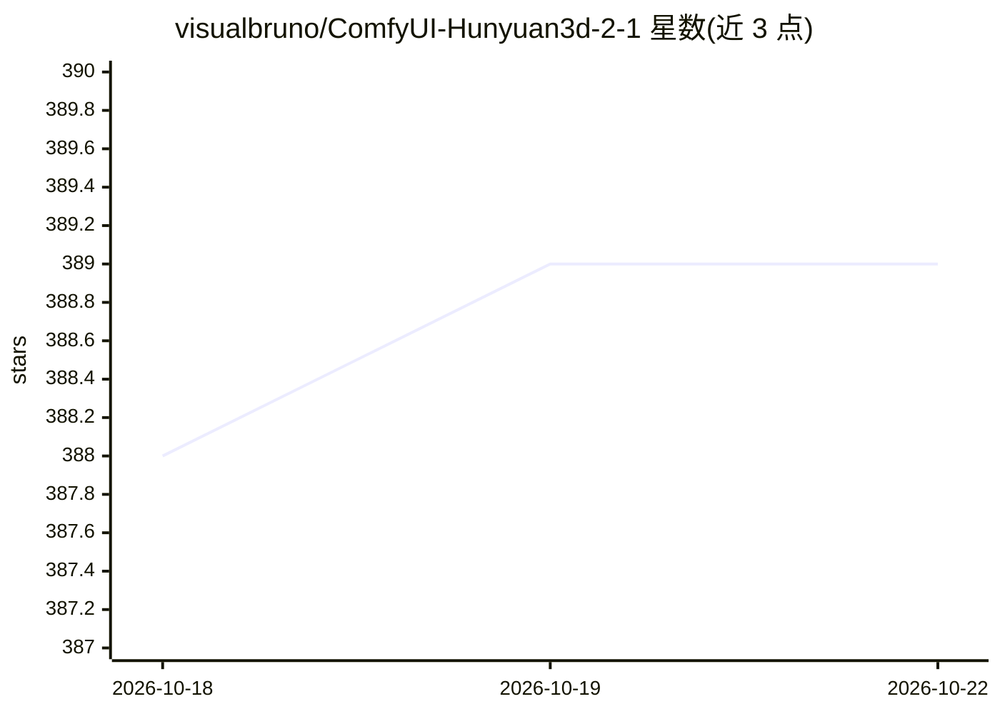

# visualbruno/ComfyUI-Hunyuan3d-2-1

⭐ 389 · Python · NOASSERTION · 推送 2026-09-08 · [GitHub](https://github.com/visualbruno/ComfyUI-Hunyuan3d-2-1) · 个人维护

**ComfyUI 中运行腾讯 Hunyuan3D-2.1 的图生 3D 自定义节点封装**

将腾讯 Hunyuan3D-2.1 模型封装为 ComfyUI 自定义节点的集成项目，支持从图像生成带纹理的 3D 资产，并提供可选的高质量 UV 展开（修补版 Xatlas）。安装需先放置 DiT 与 VAE 检查点到 ComfyUI 模型目录，再安装 Python 依赖与两个 C++ 扩展（自定义光栅器、可微渲染器）——提供 Windows 预编译 wheel，也可手动编译；在 Windows 11 / Python 3.12 / Torch 2.6.0 + cu126 环境测试，兼容 ComfyUI Portable。基于 kijai 的 Hunyuan3D v2.0 封装开发。

## 筛选速览

| 维度 | 判定 | 备注 |
|---|---|---|
| AI 角色 | `ai-ecosystem` | LLM/agent 周边工具 |
| 许可风险 | `none` | NOASSERTION |
| 部署形态 | `desktop` | 安装包/桌面程序 |
| 模型依赖 | — | README 未给出锁定关系 |
| 硬件要求 | — | 无带数字的原话,不猜 |
| 安装摩擦 | `medium` | 含编译或系统依赖之一 |
| 成熟度 | — | 结构信号不足 |

## 能力要点

- 图生带纹理 3D 资产，支持可选高质量 UV 映射
- 两个 C++ 扩展提供 Windows 预编译 wheel，也支持手动编译
- 修补版 Xatlas 改善高面数网格的 UV 展开稳定性
- 兼容 ComfyUI 标准环境与 Portable 版

## 适用场景

- 在 ComfyUI 工作流中从图片生成带 PBR 纹理的 3D 模型
- 为 3D 创作管线批量产出可用的 3D 资产
- 对复杂网格做高质量 UV 展开

## 场景标签

 · 领域:3D 生成/生成式 AI 工具链

## 证据(README 行号)

> L1: # 🌀 ComfyUI Wrapper for Hunyuan3D-2.1
> L3: > **ComfyUI integration** for Tencent's powerful **Hunyuan3D-2.1** model. Supports textured 3D generation with optio
> L26: > Tested on **Windows 11** with **Python 3.12** and **Torch >= 2.6.0 + cu126**. Compatible with the latest ComfyUI 

## 星数曲线

2026-10-18 388 → 2026-10-22 389（+1）

---
*卡片 v1 · prompt 1.4 · 生成 2026-10-21 · 置信度 high · 依据 README sha `52ff0edb3559` · [字段定义](../../DATASET.md)*
