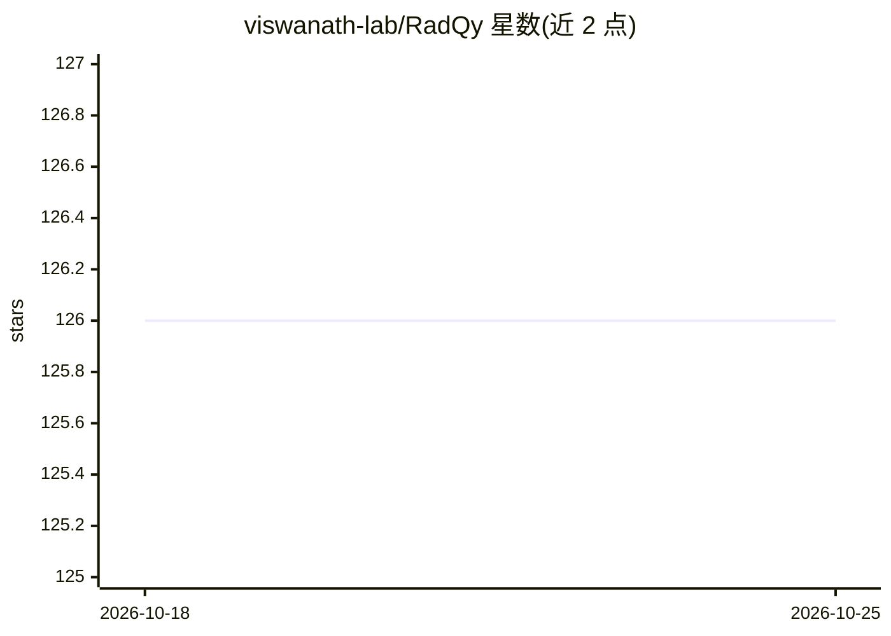

# viswanath-lab/RadQy

⭐ 126 · JavaScript · 推送 2026-10-22 · [GitHub](https://github.com/viswanath-lab/RadQy) · [官网](https://viswanath-lab.github.io/RadQy/) · 组织维护

**MRI/CT 影像数据质量评估与可视化审查平台**

面向 MRI 和 CT 影像数据集的质量保证工具：后端读取 DICOM 与 NIfTI 输入，提取 DICOM 元数据/标签、计算图像质量指标、生成参与者层面缩略图与可选前/背景分割掩码（含 otsuhull/adaptiveborder/unet 选项）；输出 results.tsv。配套浏览器前端支持排序表、平行坐标图、UMAP 可视化、标注筛选与 Excel 导出，可选的 AI 辅助报告功能需 OpenAI API key。以 git clone 源码 + conda/pip 安装依赖方式运行。限制：不支持 4D NIfTI。

## 筛选速览

| 维度 | 判定 | 备注 |
|---|---|---|
| AI 角色 | `ai-enhanced` | 去掉 AI 部分产品仍成立 |
| 许可风险 | `none` | — |
| 部署形态 | `library` | 以包/库形式分发 |
| 模型依赖 | — | README 未给出锁定关系 |
| 硬件要求 | — | 无带数字的原话,不猜 |
| 安装摩擦 | `low` | 无编译、无系统依赖或容器化 |
| 成熟度 | — | 结构信号不足 |

## 能力要点

- DICOM 元数据/标签提取与图像质量指标计算
- 浏览器前端：可排序表、平行坐标图、UMAP、Cohort Finder 聚类分组
- 三种分割选项（otsuhull/adaptiveborder/unet）生成前/背景掩码
- 可选 LLM 辅助质量报告与数据集问答（需 OpenAI API key）

## 适用场景

- 批量检查 MRI/CT 数据集的成像质量并导出指标表
- 研究队列可视化审查、标注筛选与 train/test 划分
- 为数据集生成质量评估报告并提问数据相关内容

## 场景标签

`图像视频处理` · 领域:感知与多模态

## 证据(README 行号)

> L3: RadQy is a quality assurance and evaluation platform for MRI and CT imaging datasets. It extracts metadata, computes
> L139: - **AI-assisted reporting:** Generate a quality assessment report and ask questions about the loaded dataset. This

## 星数曲线

2026-10-18 126 → 2026-10-25 126（+0）

---
*卡片 v1 · prompt 1.4 · 生成 2026-10-23 · 置信度 mid · 依据 README sha `1c3f1aecc10b` · [字段定义](../../DATASET.md)*
