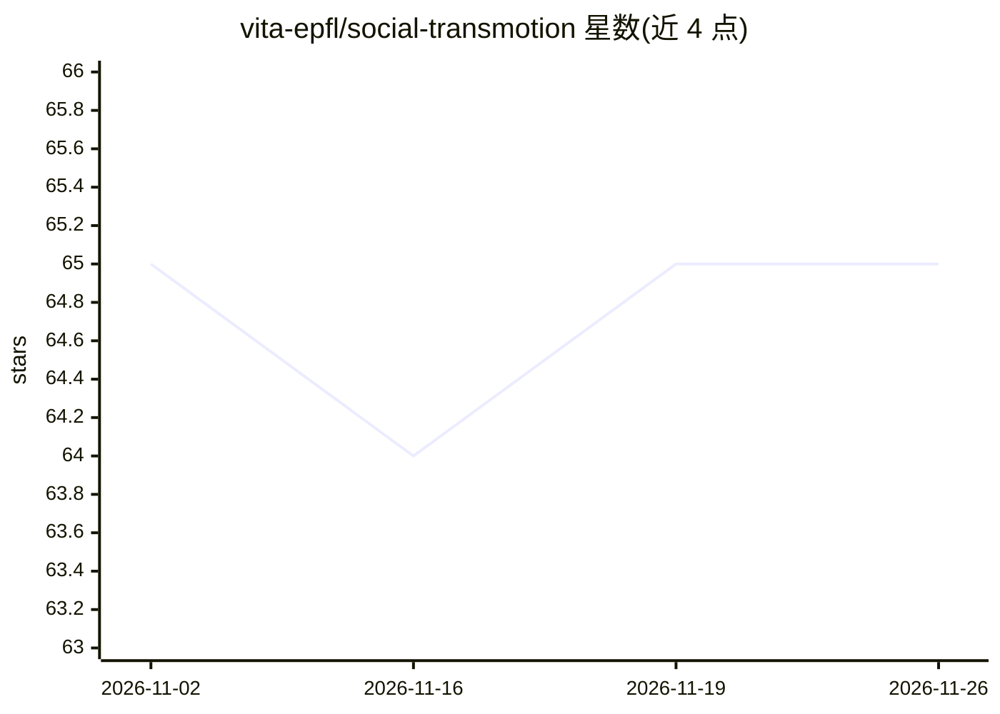

# vita-epfl/social-transmotion

⭐ 65 · Python · AGPL-3.0 · 推送 2026-11-02 · [GitHub](https://github.com/vita-epfl/social-transmotion) · 组织维护

**ICLR 2024 行人轨迹预测模型的官方 PyTorch 实现**

Social-Transmotion 是 ICLR 2024 论文的官方实现：基于 Transformer 的通用行人轨迹预测模型，将 NLP 的 prompt 概念迁移到轨迹预测，prompt 可为地面 x-y 坐标序列、图像平面边界框或 2D/3D 人体姿态关键点；通过 masking 技术基于可用视觉线索捕捉智能体间的时空交互。在 JTA、JRDB、ETH-UCY 等数据集上验证，提供训练与评估脚本、预处理数据与训练好的 checkpoint。仓库声明为 work-in-progress，将持续更新。

## 筛选速览

| 维度 | 判定 | 备注 |
|---|---|---|
| AI 角色 | `ai-native` | 本体是模型或模型工具 |
| 许可风险 | `viral` | AGPL-3.0 |
| 部署形态 | `library` | 以包/库形式分发 |
| 模型依赖 | — | README 未给出锁定关系 |
| 硬件要求 | — | 无带数字的原话,不猜 |
| 安装摩擦 | `low` | 无编译、无系统依赖或容器化 |
| 成熟度 | `idea` | |

## 能力要点

- 支持多种 prompt 形式：轨迹坐标、边界框、2D/3D 姿态关键点
- masking 技术处理不同可用视觉线索的组合
- 提供 JTA/JRDB 数据集的训练与评估命令及预训练 checkpoint
- 评估模态可选 traj/2dbox/3dpose 等多种组合

## 适用场景

- 在 JTA 或 JRDB 数据集上训练轨迹预测模型
- 用预训练 checkpoint 直接评估轨迹预测效果
- 自动驾驶、机器人、监控场景下的人体行为预测研究

## 场景标签

 · 领域:计算机视觉/轨迹预测

## 证据(README 行号)

> L1: Social-Transmotion: Promptable Human Trajectory Prediction
> L12: Accurate human trajectory prediction is crucial for applications such as autonomous vehicles, robotics, and surveil

## 星数曲线

2026-11-02 65 → 2026-11-26 65（+0）

---
*卡片 v1 · prompt 1.4 · 生成 2026-11-18 · 置信度 high · 依据 README sha `62d51505fa73` · [字段定义](../../DATASET.md)*
