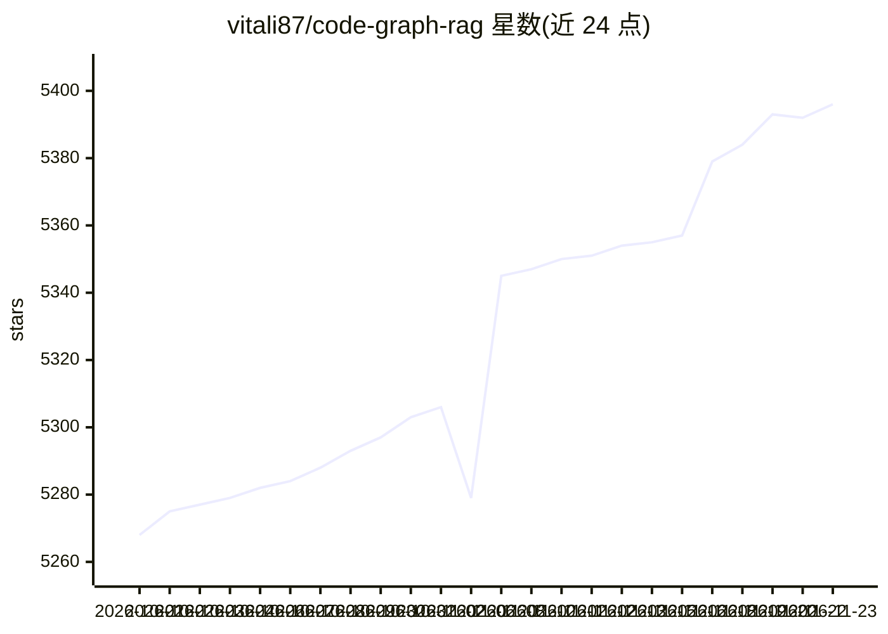

# vitali87/code-graph-rag

⭐ 5,396 · Python · MIT · 推送 2026-11-22 · [GitHub](https://github.com/vitali87/code-graph-rag) · [官网](https://code-graph-rag.com) · 个人维护

**面向开发者的代码库知识图谱 RAG 工具**

Code-Graph-RAG 用 Tree-sitter 解析多语言代码库，提取函数、类、方法及关系并存入内嵌 SQLite 图数据库，通过自然语言查询、检索和编辑代码。支持 14 种语言的完整解析与更多语言的结构级支持，可叠加编译器级前端（libclang、go/types 等）与运行时 trace。以 PyPI 包分发 CLI 工具 `cgr`，需 Python 3.12+ 与 ripgrep，也可作为 MCP server 供 Claude Code 等 MCP 客户端调用查询与编辑代码库。

## 筛选速览

| 维度 | 判定 | 备注 |
|---|---|---|
| AI 角色 | `ai-ecosystem` | LLM/agent 周边工具 |
| 许可风险 | `permissive` | MIT |
| 部署形态 | `library` | 以包/库形式分发 |
| 模型依赖 | — | README 未给出锁定关系 |
| 硬件要求 | — | 无带数字的原话,不猜 |
| 安装摩擦 | `low` | 无编译、无系统依赖或容器化 |
| 成熟度 | — | 结构信号不足 |

## 能力要点

- Tree-sitter 多语言解析构建统一 schema 的知识图谱
- 内嵌 SQLite 图数据库，默认无需运行数据库服务器
- 自然语言转 Cypher 查询与 AST 级外科式代码编辑（带 diff 预览）
- 可作为 MCP server 供 Claude Code 等 MCP 客户端接入

## 适用场景

- 对 monorepo 以自然语言提问并获取基于真实结构的回答
- 按调用/引用边查找死代码并进行结构化搜索与重写
- 合并运行时 trace 暴露静态分析看不到的动态分发
- 让 Claude Code 等 MCP 客户端直接查询和编辑代码库

## 场景标签

`知识图谱` `RAG` · 领域:知识与检索

## 证据(README 行号)

> L35: Code-Graph-RAG parses a multi-language codebase with Tree-sitter, sharpened by compiler-grade frontends and runtime
> L69: 2. **RAG system** (`codebase_rag/`). An interactive CLI that turns natural language into Cypher queries, retrieves 
> L155: Code-Graph-RAG runs as an MCP server so Claude Code and other MCP clients can query and edit your codebase directl

## 星数曲线

2026-10-21 5,268 → 2026-11-23 5,396（+128）

---
*卡片 v1 · prompt 1.4 · 生成 2026-11-23 · 置信度 high · 依据 README sha `4fd1ab6b4c6a` · [字段定义](../../DATASET.md)*
