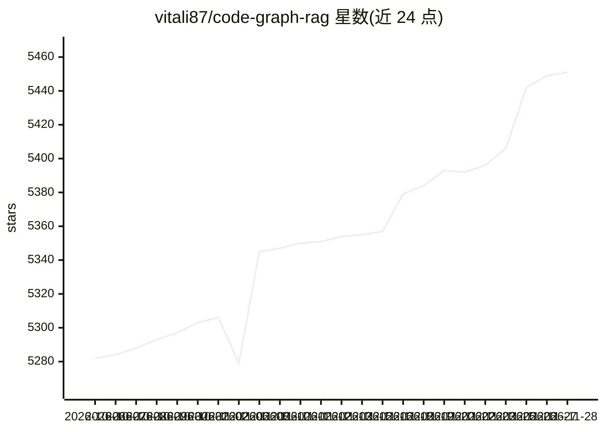

# vitali87/code-graph-rag

⭐ 5,451 · Python · MIT · 推送 2026-11-27 · [GitHub](https://github.com/vitali87/code-graph-rag) · [官网](https://code-graph-rag.com) · 个人维护

**给开发者的代码库知识图谱 RAG：自然语言查询与编辑 monorepo**

以 CLI 工具（cgr）形式发布：用 Tree-sitter 解析多语言代码库并构建知识图谱，默认存入内嵌 SQLite（无需数据库服务器），Memgraph/Neo4j 为可选后端。用户用自然语言提问时由 AI 模型生成 Cypher 查询，检索代码并驱动 AI 编辑与优化，支持 AST 精确补丁、diff 预览、死代码检测、运行时追踪（cgr trace）合并调用边。亦可作为 MCP server 供 Claude Code 等 MCP 客户端接入。安装需 Python 3.12+ 与 ripgrep，仅支持特定平台的原生扩展。

## 筛选速览

| 维度 | 判定 | 备注 |
|---|---|---|
| AI 角色 | `ai-native` | 本体是模型或模型工具 |
| 许可风险 | `permissive` | MIT |
| 部署形态 | `library` | 以包/库形式分发 |
| 模型依赖 | — | README 未给出锁定关系 |
| 硬件要求 | — | 无带数字的原话,不猜 |
| 安装摩擦 | `low` | 无编译、无系统依赖或容器化 |
| 成熟度 | — | 结构信号不足 |

## 能力要点

- Tree-sitter 解析多语言代码库生成统一 schema 的知识图谱
- 自然语言转 Cypher 查询，AI 驱动 AST 级代码编辑与 diff 预览
- cgr trace 合并运行时调用边，补充静态分析无法覆盖的 dispatch
- 可作为 MCP server 供 Claude Code 等 MCP 客户端直接查询与编辑

## 适用场景

- 在大型 monorepo 中用自然语言提问理解代码结构
- 让 agent 基于图谱做外科手术式的代码修改并预览 diff
- 从入口点沿调用边查找死代码
- 在 Claude Code 中接入 MCP server 查询和编辑代码库

## 场景标签

`编码 Agent` `知识图谱` `RAG` · 领域:编码与开发

## 证据(README 行号)

> L35: Code-Graph-RAG parses a multi-language codebase with Tree-sitter, sharpened by compiler-grade frontends and runtime
> L72: 2. **RAG system** (`codebase_rag/`). An interactive CLI that turns natural language into Cypher queries, retrieves 
> L158: Code-Graph-RAG runs as an MCP server so Claude Code and other MCP clients can query and edit your codebase directl

## 星数曲线

2026-10-26 5,282 → 2026-11-28 5,451（+169）

---
*卡片 v1 · prompt 1.4 · 生成 2026-11-27 · 置信度 high · 依据 README sha `be0047377dd2` · [字段定义](../../DATASET.md)*
