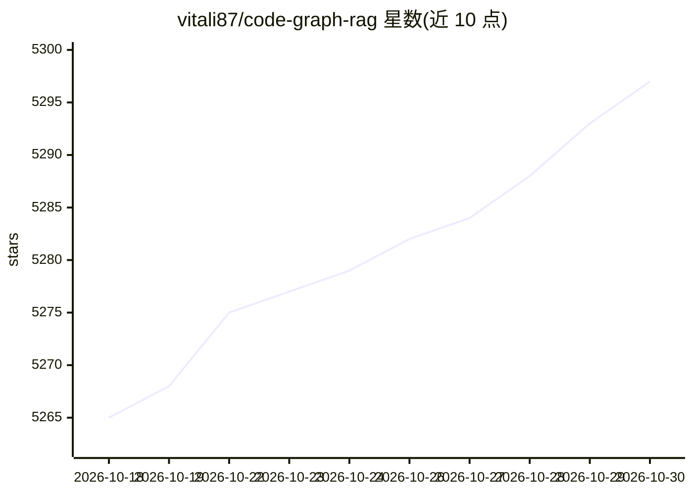

# vitali87/code-graph-rag

⭐ 5,297 · Python · MIT · 推送 2026-10-29 · [GitHub](https://github.com/vitali87/code-graph-rag) · [官网](https://code-graph-rag.com) · 个人维护

**把多语言代码库解析成知识图谱，用自然语言查询与编辑代码的 CLI 工具**

面向开发者的代码库 RAG 工具：用 Tree-sitter 解析多语言仓库（可选叠加 libclang、go/types 等编译器前端与运行时 trace），把函数、类、方法及其关系存入内嵌 SQLite 图数据库（默认无需服务器，Memgraph/Neo4j 为可选后端）。提供 CLI：自然语言问答（生成 Cypher 查询）、按名检索源码、基于 AST 的补丁式代码编辑、死代码检测、ast-grep 结构搜索与运行时调用追踪。也可作为 MCP server 供 Claude Code 等 MCP 客户端使用。要求 Python 3.12+ 与 ripgrep。

## 筛选速览

| 维度 | 判定 | 备注 |
|---|---|---|
| AI 角色 | `ai-native` | 本体是模型或模型工具 |
| 许可风险 | `permissive` | MIT |
| 部署形态 | `library` | 以包/库形式分发 |
| 模型依赖 | — | README 未给出锁定关系 |
| 硬件要求 | — | 无带数字的原话,不猜 |
| 安装摩擦 | `low` | 无编译、无系统依赖或容器化 |
| 成熟度 | — | 结构信号不足 |

## 能力要点

- Tree-sitter 多语言解析，单一语言无关图 schema 统一索引混合语言 monorepo
- 自然语言转 Cypher 查询，回答基于真实代码结构
- AST 手术式补丁编辑代码并带 diff 预览
- 可叠加运行时 trace（测试运行或 eBPF profile）暴露静态分析看不到的调用

## 适用场景

- 在大型 monorepo 中用自然语言提问并定位真实代码结构
- 让 agent 检索并编辑代码，带 diff 预览确认
- 从入口点遍历调用边找出死代码
- 把测试运行的实际调用合并进图谱，补全动态分派信息

## 场景标签

`知识图谱` `RAG` · 领域:知识与检索

## 证据(README 行号)

> L35: Code-Graph-RAG parses a multi-language codebase with Tree-sitter, sharpened by compiler-grade frontends and runtime
> L68: 2. **RAG system** (`codebase_rag/`). An interactive CLI that turns natural language into Cypher queries, retrieves 
> L73: User Query -> AI Model (Cypher Gen) -> Cypher Query -> Graph Results -> Response

## 星数曲线

2026-10-18 5,265 → 2026-10-30 5,297（+32）

---
*卡片 v1 · prompt 1.4 · 生成 2026-10-20 · 置信度 high · 依据 README sha `5f1164d32c18` · [字段定义](../../DATASET.md)*
