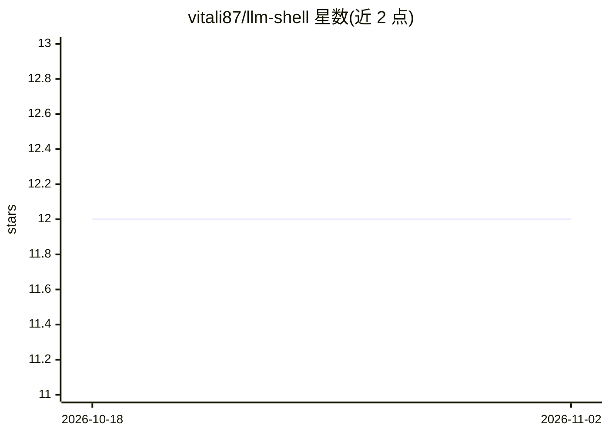

# vitali87/llm-shell

⭐ 12 · Python · MIT · 推送 2026-10-25 · [GitHub](https://github.com/vitali87/llm-shell) · [官网](https://ollama.com/vitali87/shell-commands) · 个人维护

**Zsh 终端 AI 助手：自然语言生成 shell 命令（本地 Ollama）**

Zsh 插件：在终端提示符输入自然语言问题（如列出 24 小时内修改的文件），按 Ctrl+B 将查询发送到本地运行的 Ollama 模型，生成对应 shell 命令并以 y/n 确认执行，全程本地不外发数据。默认模型 vitali87/shell-commands，可用 set_ollama_model 切换其他 Ollama 模型。要求 Unix 系统、Zsh、Python 3.11、jq 与本地 Ollama，通过 install.sh 脚本安装，颜色等可自定义。

## 筛选速览

| 维度 | 判定 | 备注 |
|---|---|---|
| AI 角色 | `ai-native` | 本体是模型或模型工具 |
| 许可风险 | `permissive` | MIT |
| 部署形态 | `None` |  |
| 模型依赖 | local-ok | 支持本地模型 |
| 硬件要求 | — | 无带数字的原话,不猜 |
| 安装摩擦 | `low` | 无编译、无系统依赖或容器化 |
| 成熟度 | — | 结构信号不足 |

## 能力要点

- Ctrl+B 触发自然语言查询生成 shell 命令
- 依赖本地 Ollama，100% 本地执行不外发查询
- 支持切换 Ollama 模型（默认 vitali87/shell-commands）
- install.sh 一键安装，可自定义颜色

## 适用场景

- 忘记命令语法时用自然语言查命令
- 在保持隐私的前提下用本地模型辅助终端操作
- 快速生成 find 等复杂命令并确认执行

## 场景标签

`AI 助手` `代码生成` · 领域:编码与开发

## 证据(README 行号)

> L14: This project enhances your Zsh terminal by allowing you to input natural language queries for shell commands you ca
> L30: Uses your locally running Ollama instance with a finetuned model

## 星数曲线

2026-10-18 12 → 2026-11-02 12（+0）

---
*卡片 v1 · prompt 1.4 · 生成 2026-10-31 · 置信度 high · 依据 README sha `7384f5928a05` · [字段定义](../../DATASET.md)*
