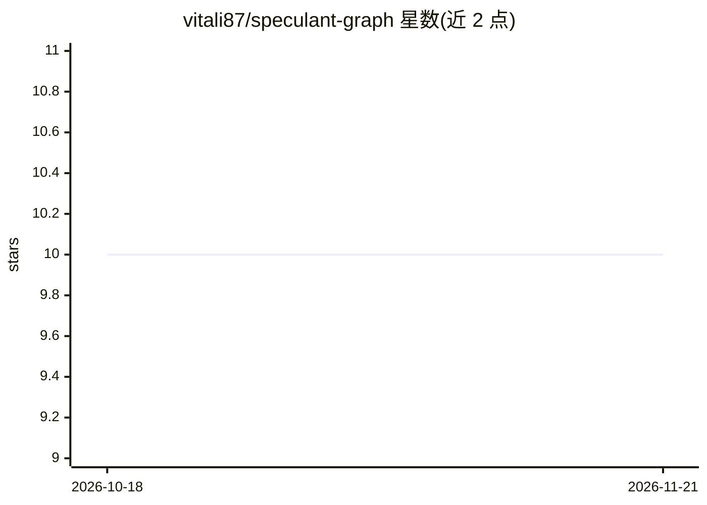

# vitali87/speculant-graph

⭐ 10 · Python · MIT · 推送 2026-10-25 · [GitHub](https://github.com/vitali87/speculant-graph) · 个人维护

**用 n-gram 图替代小模型的投机解码框架：加速 LLM 推理**

以多阶 n-gram 图（1-5 阶马尔可夫链）替代小型草稿模型实现投机解码：从用户提供的领域语料构建图结构起草 token，由大型 HuggingFace 验证模型通过拒绝采样接受/拒绝，保证输出分布与自回归生成一致。默认使用注意力机制混合多阶上下文，无需训练草稿模型，转换可追溯至源文本。以 Python 库形式提供，附带服务器模式（REST API）与基准脚本，README 称在 2 万维基百科语料上获得 2-5x 加速。

## 筛选速览

| 维度 | 判定 | 备注 |
|---|---|---|
| AI 角色 | `ai-ecosystem` | LLM/agent 周边工具 |
| 许可风险 | `permissive` | MIT |
| 部署形态 | `library` | 以包/库形式分发 |
| 模型依赖 | — | README 未给出锁定关系 |
| 硬件要求 | — | 无带数字的原话,不猜 |
| 安装摩擦 | `medium` | 含编译或系统依赖之一 |
| 成熟度 | — | 结构信号不足 |

## 能力要点

- 多阶马尔可夫链（1-5 阶）与自适应阶次选择起草 token
- 注意力上下文混合（softmax 加权融合多阶分布）
- 拒绝采样验证保证输出分布与验证模型一致
- 服务器模式提供 /health 与 /generate 端点

## 适用场景

- 在特定领域文本（法律/金融/医疗语料）上加速大模型推理
- 为已有 HuggingFace 模型搭建免训练的草稿模型
- 基准测试对比投机解码与原生解码速度

## 场景标签

`推理引擎` · 领域:训练与推理

## 证据(README 行号)

> L24: Novel approach to speculative decoding using multi-order n-gram graphs as draft models instead of small LLMs.
> L22: # Speculative Graph Decoding

## 星数曲线

2026-10-18 10 → 2026-11-21 10（+0）

---
*卡片 v1 · prompt 1.4 · 生成 2026-11-19 · 置信度 mid · 依据 README sha `f9faea32290c` · [字段定义](../../DATASET.md)*
