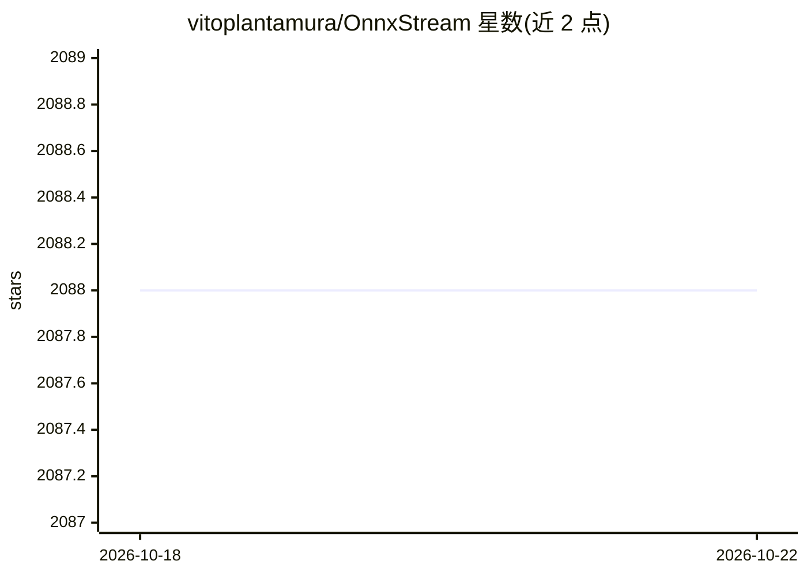

# vitoplantamura/OnnxStream

⭐ 2,088 · C++ · NOASSERTION · 推送 2026-06-18 · [GitHub](https://github.com/vitoplantamura/OnnxStream) · [官网](https://whisper.vitoplantamura.com/) · 个人维护

**C++ 极低内存 ONNX 推理库，可在 RPI Zero 2 跑 SDXL**

以最小化内存消耗为目标的 C++ ONNX 推理库：将推理引擎与负责提供模型权重的 WeightsProvider（DiskNoCache/DiskPrefetch/Ram/自定义流式）解耦，实现权重按需流式读取而不落盘；配合 attention slicing、动态/静态量化（UINT8）、FP16 支持与 XNNPACK 加速的 41 个 ONNX 算子。可在 512MB 内存的树莓派 Zero 2 上运行 Stable Diffusion 1.5/SDXL/SDXL Turbo，也支持 TinyLlama 1.1B 与 Mistral 7B 的 LLM 聊天应用（含 cuBLAS 初步 GPU 支持）。提供 Python、C# 与 JS(WASM) 绑定，支持 ARM/x86/WASM/RISC-V，从源码构建。限制：目前不支持 batch size != 1 的输入。

## 筛选速览

| 维度 | 判定 | 备注 |
|---|---|---|
| AI 角色 | `ai-ecosystem` | LLM/agent 周边工具 |
| 许可风险 | `none` | NOASSERTION |
| 部署形态 | `None` |  |
| 模型依赖 | — | README 未给出锁定关系 |
| 硬件要求 | — | 无带数字的原话,不猜 |
| 安装摩擦 | `medium` | 含编译或系统依赖之一 |
| 成熟度 | `idea` | |

## 能力要点

- 推理引擎与 WeightsProvider 解耦，支持权重流式加载不写盘
- 在 298MB 内存内运行 SDXL 1.0（tiled decoding + 量化）
- 实现 41 个常用 ONNX 算子，XNNPACK 加速
- 支持 ARM/x86/WASM/RISC-V，提供 Python/C#/JS 绑定

## 适用场景

- 在树莓派等低内存设备上运行 Stable Diffusion 等大模型
- 内存受限环境（如 TinyML）下的 ONNX 模型推理
- 浏览器中通过 WebAssembly 运行 Whisper、YOLOv8 等模型

## 场景标签

`推理引擎` · 领域:训练与推理

## 证据(README 行号)

> L32: Generally major machine learning frameworks and libraries are focused on minimizing inference latency and/or maximi
> L34: OnnxStream is based on the idea of decoupling the inference engine from the component responsible of providing the 

## 星数曲线

2026-10-18 2,088 → 2026-10-22 2,088（+0）

---
*卡片 v1 · prompt 1.4 · 生成 2026-10-21 · 置信度 high · 依据 README sha `8e308c64ff4e` · [字段定义](../../DATASET.md)*
