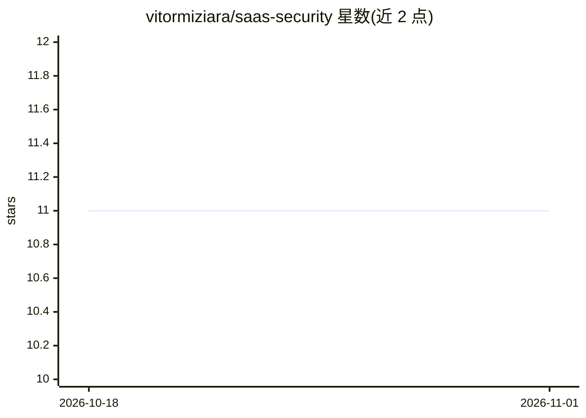

# vitormiziara/saas-security

⭐ 11 · MIT · 推送 2026-03-30 · [GitHub](https://github.com/vitormiziara/saas-security) · 个人维护

**让 Claude 具备 SaaS 安全审计能力的技能包（16 域 95 项检查）**

面向 Claude（Claude.ai Skills / Claude Code）的技能包：安装后 Claude 可对任意技术栈代码执行安全审计，覆盖 OWASP Top 10 及竞态条件、文件上传、AI/LLM 安全等 16 个域共 95 项检查，生成带严重度评分与修复优先级的结构化报告，并可生成安全清单、随功能测试编写安全测试。技能内含不可覆盖规则：拒绝硬编码密钥、默认不安全即加防护。提供 .skill 文件上传、git clone 到 Claude Code 及手动复制三种安装方式。

## 筛选速览

| 维度 | 判定 | 备注 |
|---|---|---|
| AI 角色 | `ai-ecosystem` | LLM/agent 周边工具 |
| 许可风险 | `permissive` | MIT |
| 部署形态 | `desktop` | 安装包/桌面程序 |
| 模型依赖 | locked-api |  |
| 硬件要求 | — | 无带数字的原话,不猜 |
| 安装摩擦 | `low` | 无编译、无系统依赖或容器化 |
| 成熟度 | — | 结构信号不足 |

## 能力要点

- 16 个安全域共 95 项检查（基于 OWASP Top 10:2021 / ASVS / CIS / NIST）
- 生成含严重度评分与修复路线的结构化审计报告
- 不可覆盖规则：拒绝硬编码密钥、移除防护等不安全请求
- 对生成的代码静默应用安全规则并附带安全测试

## 适用场景

- 我想在合并 PR 前对 diff 做安全审查
- 让 AI 在生成代码时自动遵守安全规则
- 为 SaaS 上线部署生成安全检查清单与审计报告

## 场景标签

`网络安全` `代码审查` · 领域:编码与开发

## 证据(README 行号)

> L3: A comprehensive Claude skill that turns your AI assistant into a senior security engineer.
> L10: - **Audit code** for vulnerabilities across 16 security domains (OWASP Top 10 + Race Conditions + File Upload + AI/

## 星数曲线

2026-10-18 11 → 2026-11-01 11（+0）

---
*卡片 v1 · prompt 1.4 · 生成 2026-11-01 · 置信度 high · 依据 README sha `e0f428e1fff0` · [字段定义](../../DATASET.md)*
