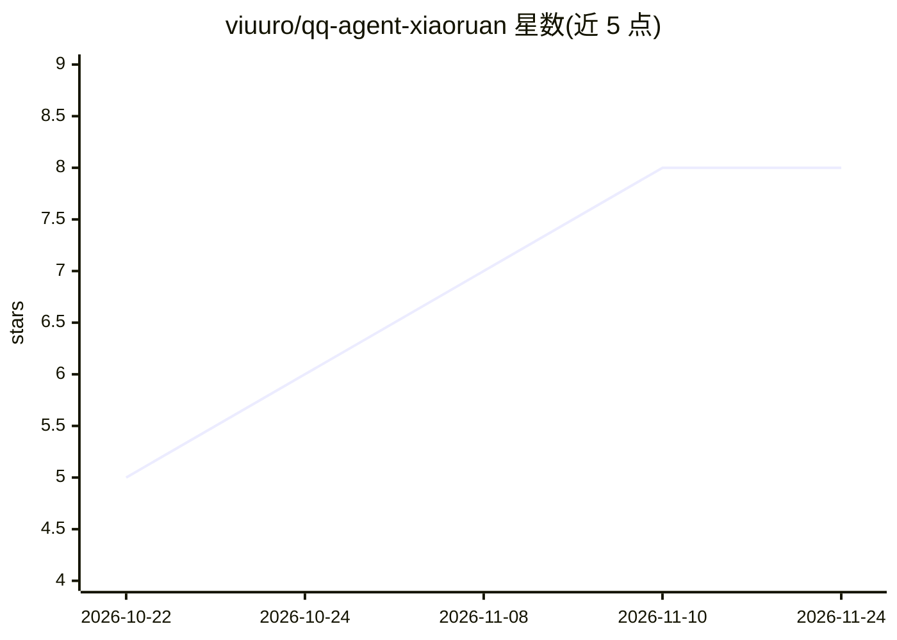

# viuuro/qq-agent-xiaoruan

⭐ 8 · JavaScript · 推送 2026-10-21 · [GitHub](https://github.com/viuuro/qq-agent-xiaoruan) · 个人维护 · 中文 README

**面向高校社团的 QQ 群 AI 机器人部署仓库与运维工具集**

一份可直接部署到云服务器的 QQ 群 AI 机器人定制仓库：机器人本体来自上游 Kondius/qq-agent（0.4.0），本仓库改为角色卡注入系统提示词并声明优先级、新增连续对话窗口（召唤后 2 分钟内按概率接话、支持分群覆盖）、控制台绑定地址可配置、只读本地图库，并补齐 Docker Compose 容器化部署与 qqdeploy 部署/回滚脚本。默认「被叫才应」，不主动插话。面向需要在 Linux 服务器上无人值守运行 QQ 机器人的维护者。

## 筛选速览

| 维度 | 判定 | 备注 |
|---|---|---|
| AI 角色 | `ai-native` | 本体是模型或模型工具 |
| 许可风险 | `none` | — |
| 部署形态 | `self-host` | docker 或自建部署 |
| 模型依赖 | — | README 未给出锁定关系 |
| 硬件要求 | — | 无带数字的原话,不猜 |
| 安装摩擦 | `low` | 无编译、无系统依赖或容器化 |
| 成熟度 | — | 结构信号不足 |

## 能力要点

- 角色卡注入系统提示词并显式声明优先级，安全规则保持最高且不可覆盖
- 连续对话窗口：召唤后 2 分钟内按概率接话，支持分群覆盖与纯函数单测
- 目录式插件系统，通过市场口令安装第三方插件（分层记忆/人设隔离/本地知识库）
- qqdeploy 部署工具：SHA 固定、健康检查、失败自动回滚、版本保留

## 适用场景

- 在云服务器上部署一个社团技术答疑 QQ 群机器人
- 通过角色卡自定义机器人的性格与身份
- 用本地知识库插件让机器人优先回答自维护文档中的内容

## 场景标签

`聊天机器人` · 领域:对话与助手

## 证据(README 行号)

> L40: 一份**可直接部署的 QQ 群 AI 机器人**，以及围绕它踩过的坑与工具。
> L18: 本仓库部署出来的机器人设定为 **小软**，身份是**软件协会的技术助手**（协会内部简称 CSUFT 软件协会）。
> L84: |被 @ 或命中关键词（= 召唤）|**必回**，并开启/续期窗口|

## 星数曲线

2026-10-22 5 → 2026-11-24 8（+3）

---
*卡片 v1 · prompt 1.4 · 生成 2026-11-20 · 置信度 mid · 依据 README sha `a0a60092fb81` · [字段定义](../../DATASET.md)*
