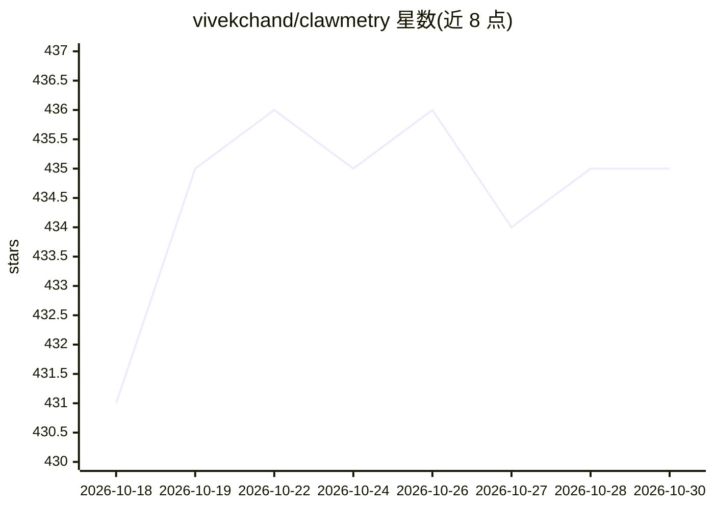

# vivekchand/clawmetry

⭐ 435 · Python · MIT · 推送 2026-10-28 · [GitHub](https://github.com/vivekchand/clawmetry) · [官网](https://clawmetry.com) · 个人维护 · 中文 README

**本地优先的 AI agent 可观测与治理面板，读取 33 种 agent 运行时会话**

读取编码 agent 已写出的本地会话文件与日志（无需 SDK 或改代码），在单一 dashboard 呈现会话时间线、工具调用回放、token/成本拆分、上下文窗口利用率、异常信号，并支持预算告警与工具调用前置审批。开源版免费读取 OpenClaw、NVIDIA NemoClaw、Goose、Qwen Code 四种运行时；其余 29 种（Claude Code、Codex、Cursor 等）由闭源 clawmetry-pro 组件按付费计划读取。默认不外传会话数据，含匿名安装 ping 与版本检查（可关闭）。pip 安装后开箱即用于 localhost:8900。

## 筛选速览

| 维度 | 判定 | 备注 |
|---|---|---|
| AI 角色 | `ai-ecosystem` | LLM/agent 周边工具 |
| 许可风险 | `permissive` | MIT |
| 部署形态 | `library` | 以包/库形式分发 |
| 模型依赖 | — | README 未给出锁定关系 |
| 硬件要求 | — | 无带数字的原话,不猜 |
| 安装摩擦 | `low` | 无编译、无系统依赖或容器化 |
| 成熟度 | `idea` | |

## 能力要点

- 读取 33 种 agent 运行时的会话文件，零配置、只读、不改运行方式
- 按 provider 独立计算上下文窗口利用率，附来源标注（model_table/default 等）
- 提供开销基准：拦截器 +0.44ms/LLM 调用，守护进程约 12% 单核，附可复现 harness
- 审批/告警（Slack/Discord/PagerDuty 等）与预算上限

## 适用场景

- 在 dashboard 上查看多个编码 agent 的会话、成本与工具调用
- 发现烧钱异常、循环卡死等浪费信号
- 在工具调用执行前暂停并从手机审批高风险操作

## 场景标签

`LLM 可观测性` · 领域:评测与运维

## 证据(README 行号)

> L11: **An agent can make a hundred tool calls without making progress.** ClawMetry
> L35: |**What it does**|Reads the session files and logs your agents already write. No SDK, no code change, no instrument
> L37: |**What's free**|`pip install clawmetry` reads **OpenClaw, NVIDIA NemoClaw, Goose and Qwen Code** with no account, 

## 星数曲线

2026-10-18 431 → 2026-10-30 435（+4）

---
*卡片 v1 · prompt 1.4 · 生成 2026-10-21 · 置信度 mid · 依据 README sha `272de77d2f3d` · [字段定义](../../DATASET.md)*
