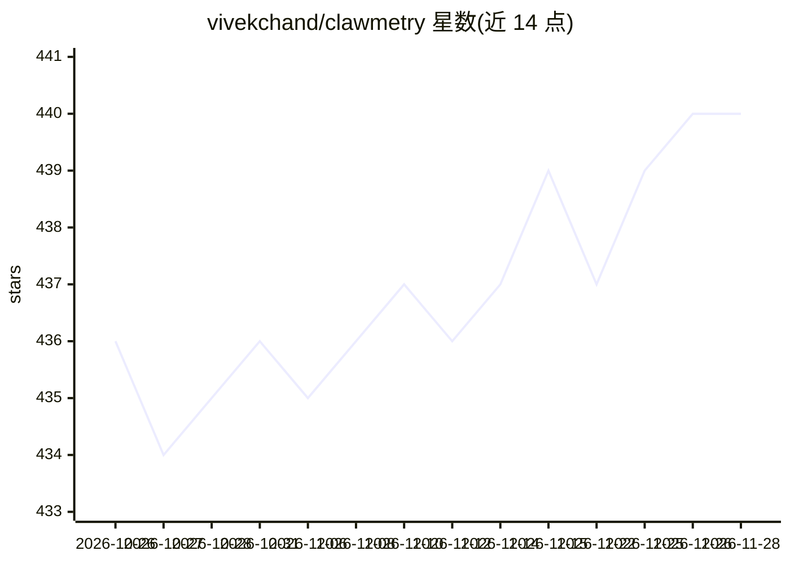

# vivekchand/clawmetry

⭐ 440 · Python · MIT · 推送 2026-11-27 · [GitHub](https://github.com/vivekchand/clawmetry) · [官网](https://clawmetry.com) · 组织维护

**为 AI agent 运行时提供会话、工具调用与成本监控的仪表盘**

读取本机各 agent 运行时已生成的会话文件与日志，无需 SDK 或改代码，聚合展示会话时间线、逐工具回放、token 与成本分解、轨迹信号（循环、重复失败）、上下文窗口占用与告警，并支持工具调用前的审批控制（opt-in）。开源版支持 4 个运行时，其余 28 个由闭源 clawmetry-pro 在付费计划下读取。提供桌面安装包与 pip 安装两种途径；物理 AI 部分连接机器人意图、遥测与操作员规则，标注为早期范围试点。

## 筛选速览

| 维度 | 判定 | 备注 |
|---|---|---|
| AI 角色 | `ai-ecosystem` | LLM/agent 周边工具 |
| 许可风险 | `permissive` | MIT |
| 部署形态 | `desktop` | 安装包/桌面程序 |
| 模型依赖 | — | README 未给出锁定关系 |
| 硬件要求 | — | 无带数字的原话,不猜 |
| 安装摩擦 | `low` | 无编译、无系统依赖或容器化 |
| 成熟度 | `idea` | |

## 能力要点

- 兼容 32 个 agent 运行时，一个仪表盘统一查看
- 读取现有会话文件，无需 SDK、改代码或插桩
- 按提供商各自的上下文窗口表计算利用率，含来源标注
- 默认本地观察，付费计划增加审批、策略与评估

## 适用场景

- 监控本机多个编码 agent 的会话与成本
- 为 agent 工具调用设置预算与风险审批
- 在物理 AI 试点中关联机器人意图、遥测与操作规则

## 场景标签

`LLM 可观测性` · 领域:评测与运维

## 证据(README 行号)

> L13: **Observability and governance for digital agents and physical AI.** Follow
> L52: |**What it does**|Reads the session files and logs your agents already write. No SDK, no code change, no instrument
> L67: **On a paid plan:** ◆ **Claude Code** · **Cursor** · 🐙 **GitHub Copilot** · ⬡ **Codex / ChatGPT Work** · ♊ **Gemini

## 星数曲线

2026-10-26 436 → 2026-11-28 440（+4）

---
*卡片 v1 · prompt 1.4 · 生成 2026-11-27 · 置信度 mid · 依据 README sha `37d343196a9d` · [字段定义](../../DATASET.md)*
