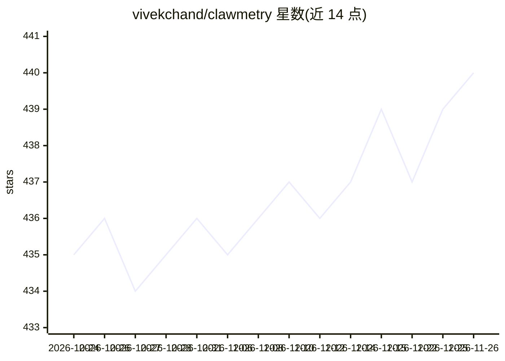

# vivekchand/clawmetry

⭐ 440 · Python · MIT · 推送 2026-11-25 · [GitHub](https://github.com/vivekchand/clawmetry) · [官网](https://clawmetry.com) · 个人维护

**给 AI agent 运行时提供零配置观测与治理仪表盘**

ClawMetry 读取编码 agent 运行时已写入的会话文件，无需 SDK 与代码改动，将会话时间线、工具调用、token 与成本数据汇入统一仪表盘，覆盖 32 种运行时，并提供预算告警、工具调用审批等治理功能。开源部分免费读取 OpenClaw、Goose、Qwen Code 等 4 种运行时，其余 28 种由闭源 clawmetry-pro 配套读取，按 Starter/Pro 订阅收费。提供桌面安装包与 pip 安装两种途径，会话数据默认留在本机。

## 筛选速览

| 维度 | 判定 | 备注 |
|---|---|---|
| AI 角色 | `ai-ecosystem` | LLM/agent 周边工具 |
| 许可风险 | `permissive` | MIT |
| 部署形态 | `desktop` | 安装包/桌面程序 |
| 模型依赖 | — | README 未给出锁定关系 |
| 硬件要求 | — | 无带数字的原话,不猜 |
| 安装摩擦 | `low` | 无编译、无系统依赖或容器化 |
| 成熟度 | — | 结构信号不足 |

## 能力要点

- 零配置读取 32 种 agent 运行时已写入的会话文件，无需 SDK 与代码改动
- 按 runtime/model/session/天 维度的 token 与成本统计，带异常标记
- 上下文窗口按 provider 分别取值，并暴露 per-runtime 的可见性覆盖报告
- 工具调用审批、预算告警（Slack/Discord/PagerDuty/Telegram/Email）

## 适用场景

- 在一台机器上同时观察多个 coding agent 的会话与开销
- 识别长时间运行中卡死/循环的 agent 会话
- 对高风险工具调用设置运行前审批
- 排查 agent 上下文窗口溢出与压缩行为

## 场景标签

`LLM 可观测性` · 领域:评测与运维

## 证据(README 行号)

> L11: **An agent can make a hundred tool calls without making progress.** ClawMetry
> L49: |**What it does**|Reads the session files and logs your agents already write. No SDK, no code change, no instrument
> L64: **On a paid plan:** ◆ **Claude Code** · **Cursor** · 🐙 **GitHub Copilot** · ⬡ **Codex / ChatGPT Work** · ♊ **Gemini

## 星数曲线

2026-10-24 435 → 2026-11-26 440（+5）

---
*卡片 v1 · prompt 1.4 · 生成 2026-11-25 · 置信度 mid · 依据 README sha `3ae873030cab` · [字段定义](../../DATASET.md)*
