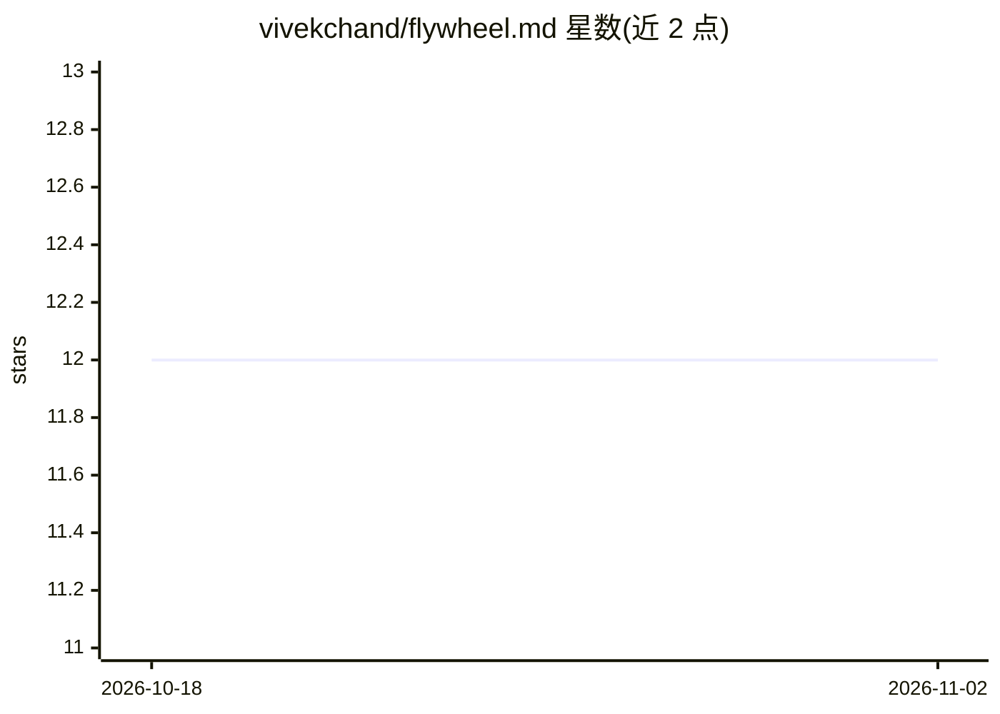

# vivekchand/flywheel.md

⭐ 12 · HTML · MIT · 推送 2026-08-19 · [GitHub](https://github.com/vivekchand/flywheel.md) · [官网](https://flywheel.md) · 个人维护

**给 AI 编程 agent 的交付准则文档：定义上线-验证-改进闭环**

一份放入仓库根目录的 Markdown 宣言文件，与 AGENTS.md、SOUL.md 并列，作为 agent 在修改代码前阅读的规范：要求'完成'定义为已部署且有验证证据，将每次迭代视为成本预算，强调掌握数据流、修复根因而非症状、留下可复用记录。核心循环为 Ship → verify → learn → improve。采用方式是手动复制文件到仓库根目录，MIT 许可，允许无署名复制与改编。

## 筛选速览

| 维度 | 判定 | 备注 |
|---|---|---|
| AI 角色 | `ai-knowledge` | 知识聚合/清单类 |
| 许可风险 | `permissive` | MIT |
| 部署形态 | `None` |  |
| 模型依赖 | — | README 未给出锁定关系 |
| 硬件要求 | — | 无带数字的原话,不猜 |
| 安装摩擦 | `low` | 无编译、无系统依赖或容器化 |
| 成熟度 | — | 结构信号不足 |

## 能力要点

- 定义 agent 交付规范的第三类标准文件（与 AGENTS.md/SOUL.md 并列）
- Ship → verify → learn → improve 四步闭环
- 'Done 意味着已部署且有验证证据'等五条准则
- MIT 许可，可自由复制与改编，无需署名

## 适用场景

- 为我的 AI 编程 agent 设定上线与验证纪律
- 配合 AGENTS.md 约束 agent 的交付行为标准
- 让 agent 的每次迭代留下可复用的执行记录

## 场景标签

 · 领域:AI 工程/开发规范

## 证据(README 行号)

> L5: **How autonomous agents ship and improve real software, end to end.**
> L37: Drop `FLYWHEEL.md` in your repo root, next to `AGENTS.md` and `SOUL.md`. Your agents read it before they touch anyt

## 星数曲线

2026-10-18 12 → 2026-11-02 12（+0）

---
*卡片 v1 · prompt 1.4 · 生成 2026-10-31 · 置信度 high · 依据 README sha `9a43a2be4431` · [字段定义](../../DATASET.md)*
