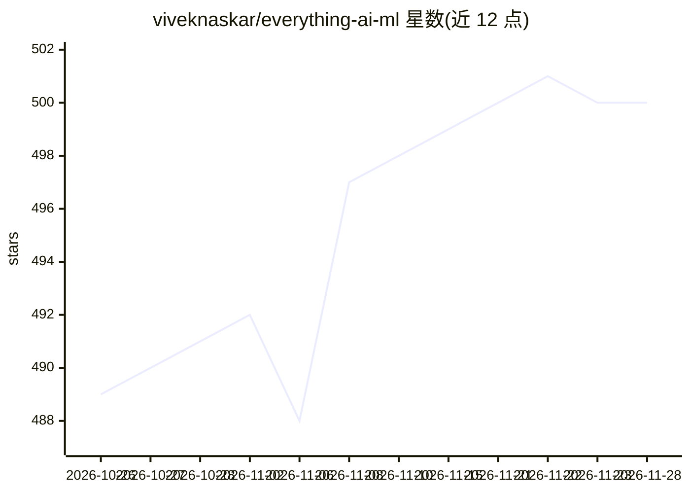

# viveknaskar/everything-ai-ml

⭐ 500 · TypeScript · MIT · 推送 2026-11-27 · [GitHub](https://github.com/viveknaskar/everything-ai-ml) · [官网](https://viveknaskar.github.io/everything-ai-ml/) · 个人维护

**AI/ML 学习资源策展清单：课程、指南、论文与可视化**

以清单形式收录生成式 AI、机器学习、Agentic AI、RAG、微调、MLOps 等主题的外部学习资源，按关键概念、数学基础、学习路线图、提示工程、框架与 Agent 等章节组织，每条附一句话说明。条目指向第三方课程（Coursera、DeepLearning.AI、fast.ai、Hugging Face 等）、官方文档、论文与交互式可视化工具，并提供 GitHub Pages 交互式速查表站点。仓库本身不含代码或模型，无安装运行环节。

## 筛选速览

| 维度 | 判定 | 备注 |
|---|---|---|
| AI 角色 | `ai-knowledge` | 知识聚合/清单类 |
| 许可风险 | `permissive` | MIT |
| 部署形态 | `None` |  |
| 模型依赖 | — | README 未给出锁定关系 |
| 硬件要求 | — | 无带数字的原话,不猜 |
| 安装摩擦 | `low` | 无编译、无系统依赖或容器化 |
| 成熟度 | — | 结构信号不足 |

## 能力要点

- 按学习路线图组织：Python→数学→ML 基础→实战→专精→MLOps→论文
- 收录交互式可视化资源（MLU-Explain、CNN/Transformer Explainer）
- 覆盖 LangChain、LangGraph、CrewAI、Google ADK、Agno 等框架的文档与课程链接
- 提供 GitHub Pages 交互式速查表站点

## 适用场景

- 寻找生成式 AI 与机器学习的入门课程和路线图
- 按主题查找提示工程、RAG、微调方向的教程
- 收集 Agentic AI 框架的官方文档与课程链接

## 场景标签

`精选清单` · 领域:学习与行业

## 证据(README 行号)

> L1: # Everything AI/ML
> L5: A curated collection of learning resources for Generative AI, Machine Learning, Agentic AI, and related topics.
> L7: > **Browse the interactive cheatsheet:** viveknaskar.github.io/everything-ai-ml

## 星数曲线

2026-10-26 489 → 2026-11-28 500（+11）

---
*卡片 v1 · prompt 1.4 · 生成 2026-11-28 · 置信度 high · 依据 README sha `a0d1bb4f97c2` · [字段定义](../../DATASET.md)*
