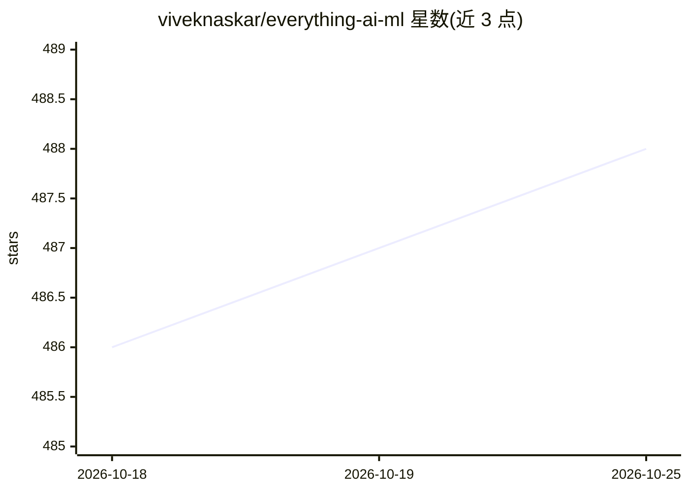

# viveknaskar/everything-ai-ml

⭐ 489 · TypeScript · MIT · 推送 2026-10-25 · [GitHub](https://github.com/viveknaskar/everything-ai-ml) · [官网](https://viveknaskar.github.io/everything-ai-ml/) · 个人维护

**AI/ML 学习资源策展清单：课程、教程与工具链接合集**

个人维护的 AI/ML 学习资源聚合清单，按主题分节组织：AI/ML 核心概念与数学基础、七步学习路线图（Python→数学→ML→实践→ specialization→MLOps→论文）、生成式 AI（初/中/高级路径与管理者课程）、Prompt 工程、RAG、Fine-tuning、框架（LangChain/LangGraph/CrewAI/Google ADK/Agno）与 Agentic AI 技能。条目为课程、文档、可视化工具与开源项目链接，附交互式速查网页。仅提供浏览，无安装运行内容。

## 筛选速览

| 维度 | 判定 | 备注 |
|---|---|---|
| AI 角色 | `ai-knowledge` | 知识聚合/清单类 |
| 许可风险 | `permissive` | MIT |
| 部署形态 | `None` |  |
| 模型依赖 | — | README 未给出锁定关系 |
| 硬件要求 | — | 无带数字的原话,不猜 |
| 安装摩擦 | `low` | 无编译、无系统依赖或容器化 |
| 成熟度 | — | 结构信号不足 |

## 能力要点

- 覆盖核心概念、路线图、GenAI、RAG、Fine-tuning、MLOps 等主题分节
- 收录 58 种提示技术的系统性调查等文档与交互式可视化资源
- 框架一节收录 LangChain/LangGraph/CrewAI/Google ADK/Agno 官方仓库与课程
- 提供在线交互式 cheatsheet 网页

## 适用场景

- 按路线图系统自学机器学习与深度学习
- 查找 RAG、Fine-tuning、Agent 框架的入门课程与文档
- 为业务与产品团队挑选生成式 AI 通识课程

## 场景标签

`教程课程` `精选清单` · 领域:学习与行业

## 证据(README 行号)

> L5: A curated collection of learning resources for Generative AI, Machine Learning, Agentic AI, and related topics.
> L11: ## Table of Contents

## 星数曲线

2026-10-18 486 → 2026-10-25 488（+2）

---
*卡片 v1 · prompt 1.4 · 生成 2026-10-21 · 置信度 high · 依据 README sha `997307a6df73` · [字段定义](../../DATASET.md)*
