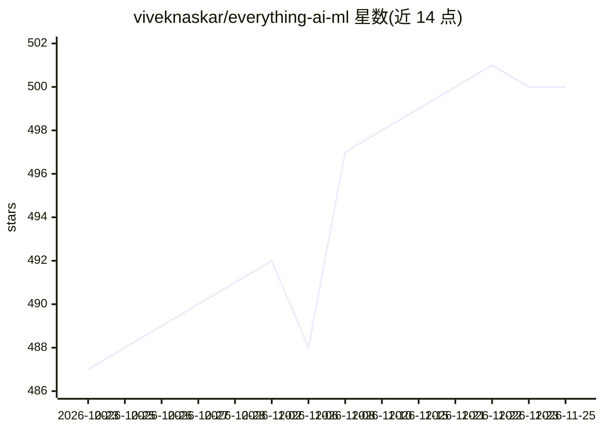

# viveknaskar/everything-ai-ml

⭐ 500 · TypeScript · MIT · 推送 2026-11-23 · [GitHub](https://github.com/viveknaskar/everything-ai-ml) · [官网](https://viveknaskar.github.io/everything-ai-ml/) · 个人维护

**AI/ML 学习资源策展清单：课程、论文、框架教程导航**

以链接清单形式组织的学习资源合集，覆盖机器学习基础概念、数学与 Python 基础、分阶段学习路线、生成式 AI、提示工程、RAG、微调、MLOps 及 Agent 框架等主题；条目指向 Coursera、DeepLearning.AI、MIT、fast.ai 等外部课程与官方文档。附 GitHub Pages 交互式 cheatsheet 站点浏览。自身不含可运行代码或模型，为纯资源导航目录。

## 筛选速览

| 维度 | 判定 | 备注 |
|---|---|---|
| AI 角色 | `ai-knowledge` | 知识聚合/清单类 |
| 许可风险 | `permissive` | MIT |
| 部署形态 | `None` |  |
| 模型依赖 | — | README 未给出锁定关系 |
| 硬件要求 | — | 无带数字的原话,不猜 |
| 安装摩擦 | `low` | 无编译、无系统依赖或容器化 |
| 成熟度 | — | 结构信号不足 |

## 能力要点

- 按学习路线分 7 阶段组织（Python→数学→ML→实践→专精→MLOps→论文）
- 覆盖 LangChain、LangGraph、CrewAI、Google ADK、Agno 等框架的学习资源
- 含交互式可视化资源（Transformer Explainer、CNN Explainer 等）
- 提供 GitHub Pages 交互式 cheatsheet 站点

## 适用场景

- 制定从 Python 基础到 MLOps 的 AI 学习路线
- 查找 RAG、微调、Agent 框架的入门课程
- 收藏常用提示工程与 Transformer 可视化教程

## 场景标签

`精选清单` · 领域:学习与行业

## 证据(README 行号)

> L5: A curated collection of learning resources for Generative AI, Machine Learning, Agentic AI, and related topics.
> L49: ## AI/ML Roadmap
> L7: > **Browse the interactive cheatsheet:** viveknaskar.github.io/everything-ai-ml

## 星数曲线

2026-10-23 487 → 2026-11-25 500（+13）

---
*卡片 v1 · prompt 1.4 · 生成 2026-11-25 · 置信度 high · 依据 README sha `d34665ec7278` · [字段定义](../../DATASET.md)*
