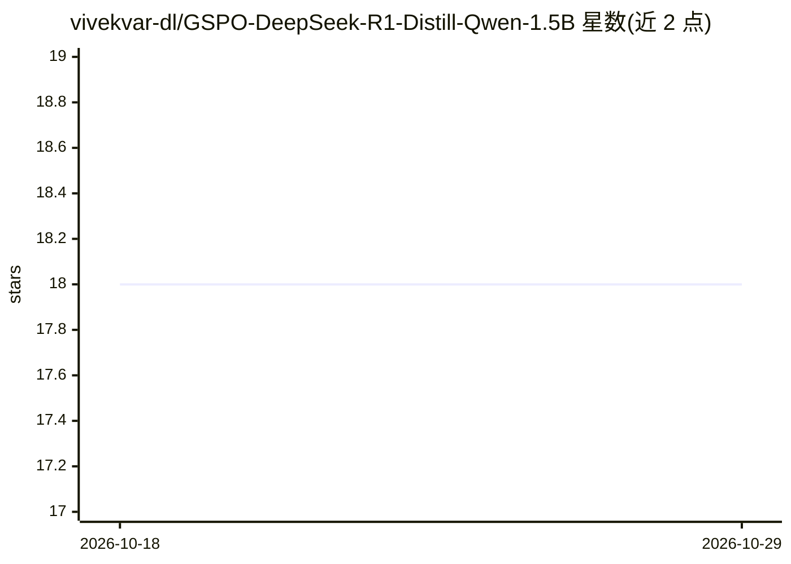

# vivekvar-dl/GSPO-DeepSeek-R1-Distill-Qwen-1.5B

⭐ 18 · Python · 推送 2026-03-15 · [GitHub](https://github.com/vivekvar-dl/GSPO-DeepSeek-R1-Distill-Qwen-1.5B) · 个人维护

**GSPO 强化学习算法的 PyTorch 实现，用于训练推理小模型**

开源实现 Zheng 等人（Qwen 团队）提出的 Group Sequence Policy Optimization 算法：以序列级重要性比率替代 token 级比率，附长度归一化，并带 PPO、GRPO 基线对比实现。以 DeepSeek-R1-Distill-Qwen-1.5B 为基础模型做训练实验，提供 GSPOTrainer、配置类、数据集与基准评测脚本。针对 NVIDIA H100 优化（8-bit 优化器、梯度检查点、bfloat16），最低 24GB VRAM。面向希望复现论文或用该算法训练模型的研究者。

## 筛选速览

| 维度 | 判定 | 备注 |
|---|---|---|
| AI 角色 | `ai-ecosystem` | LLM/agent 周边工具 |
| 许可风险 | `none` | — |
| 部署形态 | `library` | 以包/库形式分发 |
| 模型依赖 | — | README 未给出锁定关系 |
| 硬件要求 | `gpu-24g` | |
| 安装摩擦 | `medium` | 含编译或系统依赖之一 |
| 成熟度 | — | 结构信号不足 |

## 能力要点

- 序列级重要性比率 + 长度归一化的 GSPO 训练器
- 附 PPO/GRPO 基线对比与 ZebraLogic/数学基准评测脚本
- H100 优化：8-bit 优化器、梯度检查点、bfloat16 混合精度
- 已发布基于 DeepSeek-R1-Distill-Qwen-1.5B 的训练模型

## 适用场景

- 复现或验证 GSPO 论文的训练结果
- 用 GSPO 把推理能力蒸馏进 1.5B 小模型
- 对比 PPO/GRPO/GSPO 三种策略优化方法的稳定性

## 场景标签

`强化学习` · 领域:训练与推理

## 证据(README 行号)

> L10: **Open-source implementation of the GSPO algorithm by Zheng et al. (Qwen Team, Alibaba Inc.)** — optimized for NVID
> L36: - **GSPOTrainer**: Main training class implementing the GSPO algorithm

## 星数曲线

2026-10-18 18 → 2026-10-29 18（+0）

---
*卡片 v1 · prompt 1.4 · 生成 2026-10-29 · 置信度 high · 依据 README sha `8118eccb78d6` · [字段定义](../../DATASET.md)*
