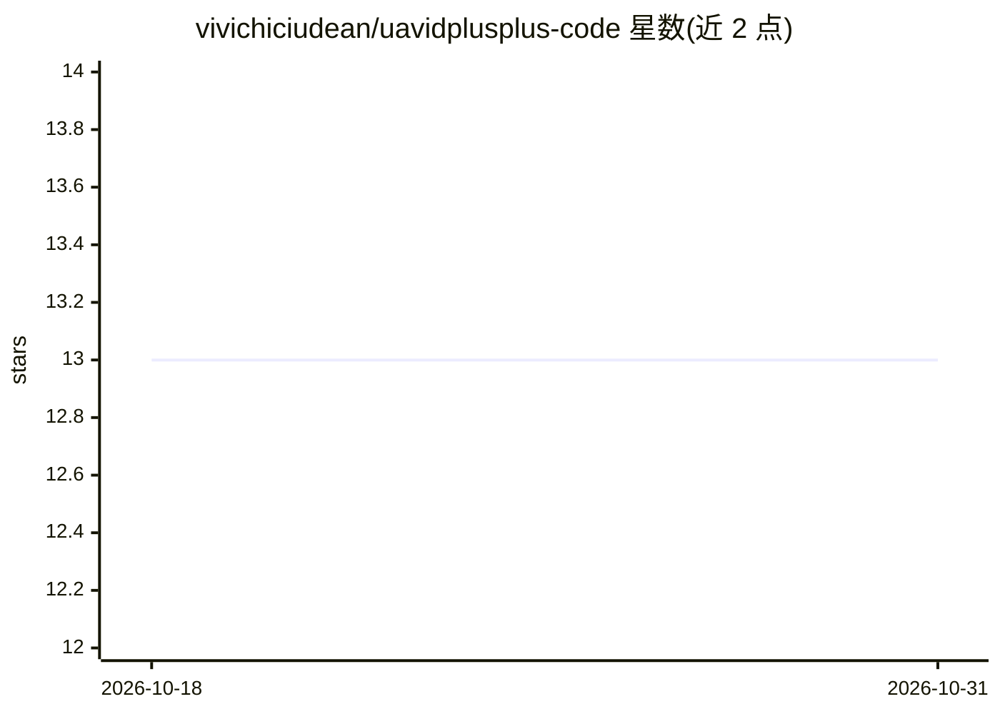

# vivichiciudean/uavidplusplus-code

⭐ 13 · Python · 推送 2026-10-09 · [GitHub](https://github.com/vivichiciudean/uavidplusplus-code) · [官网](https://vivichiciudean.github.io/uavidplusplus/) · 组织维护

**UAVid++ 论文官方代码：无人机航拍语义分割训练与推理**

IEEE TGRS 2026 论文 UAVid++ 的官方代码库，提供航拍图像语义分割的训练与推理流程：冻结 DINOv3 预训练 ViT 主干，搭配 Linear/Conv/UNet 三种可训练任务头，其中 UNet 头效果最好。包含数据集预处理脚本、训练脚本（model_train.py）与推理脚本（model_inference.py），并在 Hugging Face 提供 ViT-S/H+/7B 的预训练权重与 UAVid++ 数据集。使用需克隆 DINOv3 仓库并下载其 checkpoint，实验配置为单卡 NVIDIA A100 40GB，采用 1088×1088 分块输入。

## 筛选速览

| 维度 | 判定 | 备注 |
|---|---|---|
| AI 角色 | `ai-native` | 本体是模型或模型工具 |
| 许可风险 | `none` | — |
| 部署形态 | `None` |  |
| 模型依赖 | — | README 未给出锁定关系 |
| 硬件要求 | — | 无带数字的原话,不猜 |
| 安装摩擦 | `low` | 无编译、无系统依赖或容器化 |
| 成熟度 | — | 结构信号不足 |

## 能力要点

- 冻结 DINOv3 ViT 主干 + 三种可训练头（Linear/Conv/UNet）
- 提供 ViT-S/H+/7B 预训练 checkpoint 与预处理脚本
- 训练与推理脚本齐全，推理自动拼接分块预测为全分辨率分割图
- 论文报告在 UAVid++ 上 82.04 mIoU（ViT-7B+UNet）

## 适用场景

- 复现论文的航拍语义分割训练与评测
- 下载预训练权重直接对无人机航拍图像做语义分割推理
- 在自有 UAV 数据集上适配冻结主干+任务头的训练方案

## 场景标签

`目标检测` · 领域:感知与多模态

## 证据(README 行号)

> L14: Official code for the IEEE Transactions on Geoscience and Remote Sensing (TGRS) 2026 paper **UAVid++**. This reposi
> L22: A **frozen** DINO-pretrained ViT backbone extracts features that are decoded by a lightweight **trainable** head. T

## 星数曲线

2026-10-18 13 → 2026-10-31 13（+0）

---
*卡片 v1 · prompt 1.4 · 生成 2026-10-31 · 置信度 high · 依据 README sha `a80cc8e72eb9` · [字段定义](../../DATASET.md)*
