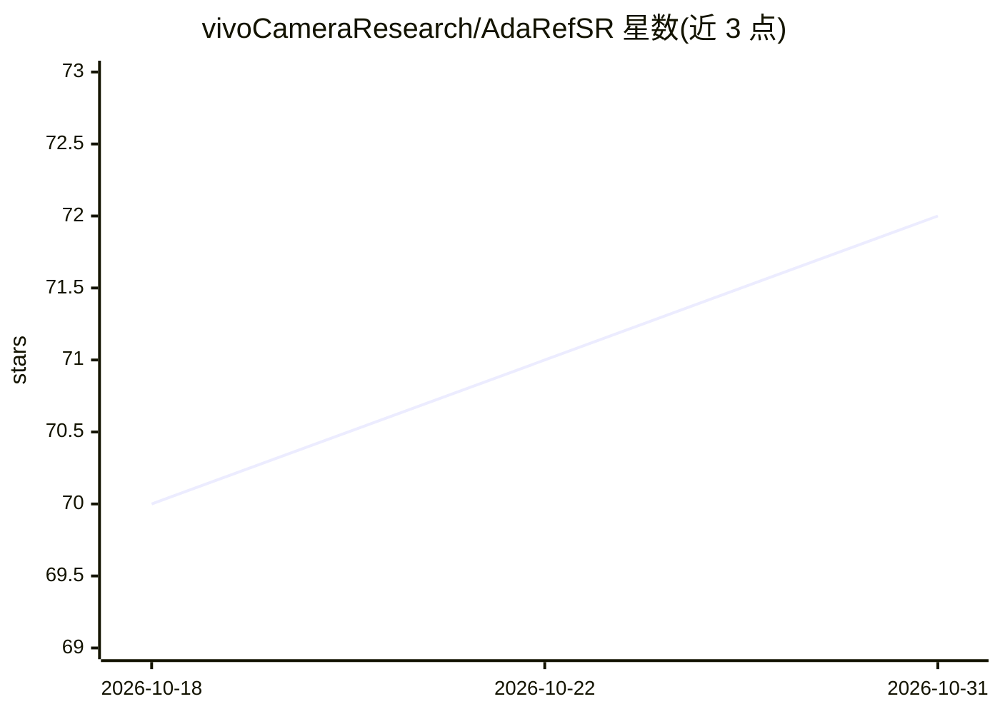

# vivoCameraResearch/AdaRefSR

⭐ 72 · Python · 推送 2026-05-19 · [GitHub](https://github.com/vivoCameraResearch/AdaRefSR) · 组织维护 · 中文 README

**基于参考图的单步扩散超分辨率研究框架（ICLR 2026）**

南开大学与 vivo 合作的参考图引导超分辨率研究代码：在 S3Diff 生成骨干上加入隐式相关性自适应门控模块 AICG，对低质输入与参考图之间的关联建模，按相关性决定参考信息的使用程度；单步扩散设计实现快于多步 RefSR 基线的推理。提供 demo 脚本、训练与验证脚本，需自行下载 SD-Turbo、S3Diff、RAM/DAPE 等预训练权重，实测在单张 NVIDIA A40 上 1024 分辨率推理需 15.54 GB 显存。

## 筛选速览

| 维度 | 判定 | 备注 |
|---|---|---|
| AI 角色 | `ai-native` | 本体是模型或模型工具 |
| 许可风险 | `none` | — |
| 部署形态 | `None` |  |
| 模型依赖 | — | README 未给出锁定关系 |
| 硬件要求 | — | 无带数字的原话,不猜 |
| 安装摩擦 | `low` | 无编译、无系统依赖或容器化 |
| 成熟度 | — | 结构信号不足 |

## 能力要点

- AICG 门控模块隐式建模低质图与参考图的相关性
- 单步扩散设计，A40 上 1024 分辨率推理 1.35 秒
- 提供 demo、训练与多基准验证脚本
- 支持人脸参考与通用参考两类数据集训练

## 适用场景

- 研究参考图引导超分方法的复现与改进
- 用自有低清图与参考图快速测试超分效果
- 在 CUFED5 等基准上做对比评估

## 场景标签

`图像视频处理` · 领域:感知与多模态

## 证据(README 行号)

> L1: [ICLR 2026]Trust but Verify: Adaptive Conditioning for Reference-Based Diffusion Super-Resolution via Implicit Refer
> L23: 🎯 **AICG: Adaptive Implicit Correlation Gating.** We propose **AICG**, a lightweight implicit correlation gating mo

## 星数曲线

2026-10-18 70 → 2026-10-31 72（+2）

---
*卡片 v1 · prompt 1.4 · 生成 2026-10-24 · 置信度 high · 依据 README sha `0a1d602bf4bb` · [字段定义](../../DATASET.md)*
