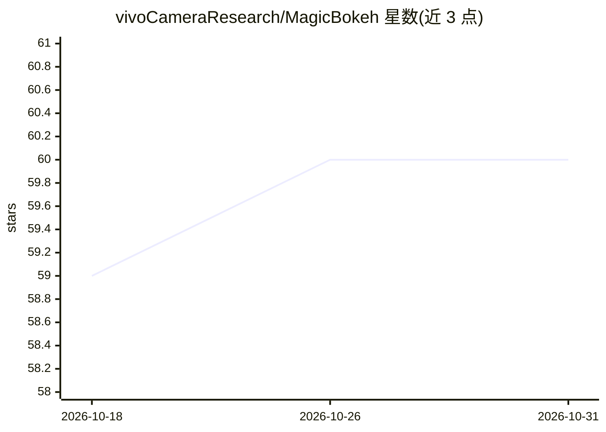

# vivoCameraResearch/MagicBokeh

⭐ 60 · Python · 推送 2026-06-17 · [GitHub](https://github.com/vivoCameraResearch/MagicBokeh) · 组织维护

**基于扩散的高倍变焦散景渲染框架（CVPR 2026 论文代码）**

面向手机摄影散景渲染的研究代码：针对高数字变焦下低分辨率输入，用统一扩散框架联合优化散景渲染与超分辨率，包含 focus-aware masked attention、交替训练策略与 degradation-aware 深度模块；推理前需先用 Depth-Anything-V2 或其 DA 深度模型与 LDF 生成深度图和显著性掩码，模型权重托管在 Hugging Face，基于 OSEDiff 与 SD2.1 骨干，提供 --K 参数控制散景强度和手动点选目标的 demo 脚本。需 Python 3.10 + PyTorch 环境，从源码运行。

## 筛选速览

| 维度 | 判定 | 备注 |
|---|---|---|
| AI 角色 | `ai-native` | 本体是模型或模型工具 |
| 许可风险 | `none` | — |
| 部署形态 | `None` |  |
| 模型依赖 | — | README 未给出锁定关系 |
| 硬件要求 | — | 无带数字的原话,不猜 |
| 安装摩擦 | `low` | 无编译、无系统依赖或容器化 |
| 成熟度 | — | 结构信号不足 |

## 能力要点

- 扩散框架联合优化散景渲染与超分辨率，单阶段替代两阶段流水线
- focus-aware masked attention 与交替训练策略
- degradation-aware 深度模块，面向低质量输入的深度估计
- 提供 demo.py 手动点选目标物体快速测试，--K 控制散景强度

## 适用场景

- 对高变焦低分辨率照片生成散景（背景虚化）效果
- 研究扩散模型在摄影渲染任务上的实现
- 复现 CVPR 2026 论文实验结果

## 场景标签

`图像生成` `图像视频处理` · 领域:内容生成

## 证据(README 行号)

> L7:  MagicBokeh is the first unified method specifically designed for high-zoom bokeh rendering.
> L12: Existing mobile devices are constrained by compact optical designs, such as small apertures, which make it difficul

## 星数曲线

2026-10-18 59 → 2026-10-31 60（+1）

---
*卡片 v1 · prompt 1.4 · 生成 2026-10-24 · 置信度 high · 依据 README sha `bb599a58c94b` · [字段定义](../../DATASET.md)*
