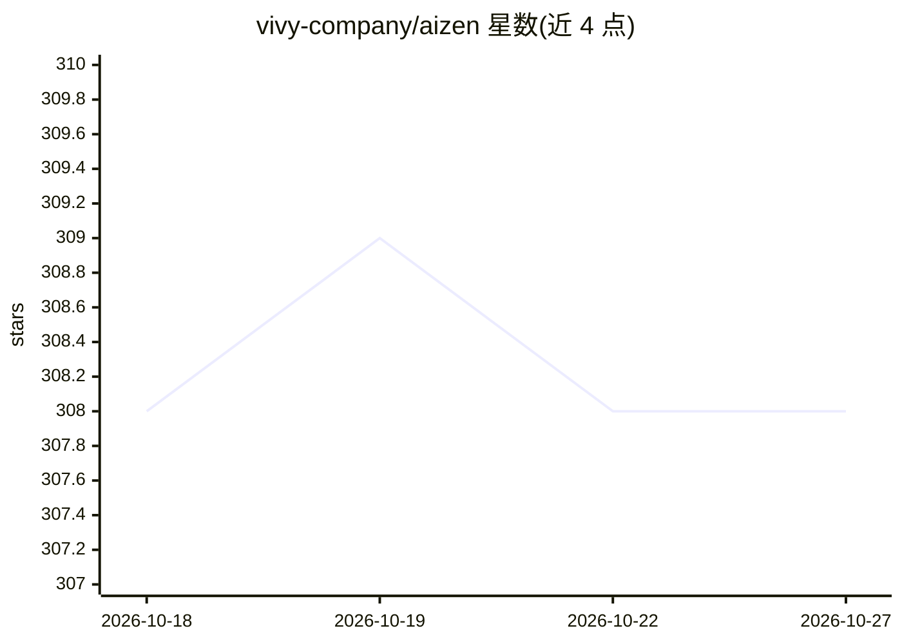

# vivy-company/aizen

⭐ 308 · Swift · GPL-3.0 · 推送 2026-08-01 · [GitHub](https://github.com/vivy-company/aizen) · [官网](https://aizen.win) · 组织维护 · 中文 README

**macOS 并行开发工作区：聚合终端、Git 与 AI agent 会话**

Swift 编写的 macOS 原生开发者工作区，按项目或 Git 分支创建隔离环境，每个环境拥有独立终端、文件浏览、内置浏览器、agent 会话与 Git 上下文；支持 worktree/文件夹/副本三种底层方式。Agent 通过 ACP registry 接入，预置 Claude Code、Codex、OpenCode，并可从内置 MCP marketplace 添加服务器。终端基于 libghostty（GPU 加速），内置 Git 操作、diff 审查、GitHub Actions/GitLab CI 可视化与 Xcode 构建集成。仅支持 macOS 13.5+ Apple Silicon，自 1.0.71 起不支持 Intel；处于 Early Access，2.0.0 将不向后兼容。

## 筛选速览

| 维度 | 判定 | 备注 |
|---|---|---|
| AI 角色 | `ai-enhanced` | 去掉 AI 部分产品仍成立 |
| 许可风险 | `viral` | GPL-3.0 |
| 部署形态 | `None` |  |
| 模型依赖 | — | README 未给出锁定关系 |
| 硬件要求 | — | 无带数字的原话,不猜 |
| 安装摩擦 | `low` | 无编译、无系统依赖或容器化 |
| 成熟度 | `idea` | |

## 能力要点

- 按项目/分支隔离的并行环境（终端、文件、浏览器、agent 会话）
- ACP registry 接入 agent，预置 Claude Code/Codex/OpenCode，含 MCP marketplace
- 基于 libghostty 的 GPU 加速终端与 tmux 会话持久化
- UI 内 Git 操作、diff 审查与 CI 运行可视化

## 适用场景

- 同时开发多个项目或分支而不手动管理 worktree
- 在同一个环境里跑终端、看 diff、审查 PR 并与 agent 对话
- 为不同 agent 会话按项目隔离上下文和 MCP 服务器

## 场景标签

 · 领域:开发工具/桌面工作区

## 证据(README 行号)

> L16: Aizen is a macOS workspace for parallel development.
> L26: Aizen is an agentic-first developer workspace for macOS. It helps you run projects and branches in parallel without
> L91: - Seeded defaults include Claude Code, Codex, and OpenCode

## 星数曲线

2026-10-18 308 → 2026-10-27 308（+0）

---
*卡片 v1 · prompt 1.4 · 生成 2026-10-21 · 置信度 high · 依据 README sha `0baed6a7b862` · [字段定义](../../DATASET.md)*
