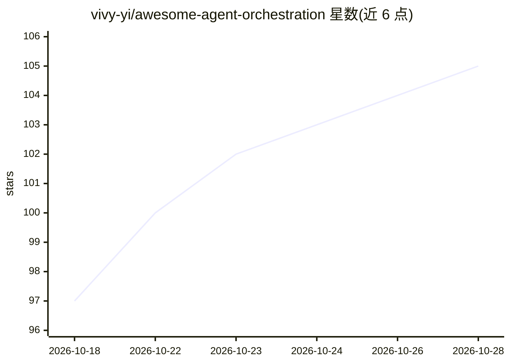

# vivy-yi/awesome-agent-orchestration

⭐ 106 · NOASSERTION · 推送 2026-03-05 · [GitHub](https://github.com/vivy-yi/awesome-agent-orchestration) · 个人维护 · 中文 README

**AI Agent 编排框架与协议策展清单（多智能体/群体智能/MCP/A2A）**

面向开发者的 Agent 编排主题 awesome 清单，收录多智能体框架（AutoGen、CrewAI、MetaGPT、LangGraph、Swarms 等）、按语言分类的框架（Python/TypeScript/Go/Swift/Ruby/Elixir/PHP/Java）、A2A 与 MCP 协议生态（官方资源、数据库、浏览器自动化、专业服务器等 MCP servers），并整理层级式、顺序式、并行式、MoA、Agent Council 等编排模式与相关研究论文。README 提供中英双语，许可为 CC0。

## 筛选速览

| 维度 | 判定 | 备注 |
|---|---|---|
| AI 角色 | `ai-knowledge` | 知识聚合/清单类 |
| 许可风险 | `none` | NOASSERTION |
| 部署形态 | `None` |  |
| 模型依赖 | — | README 未给出锁定关系 |
| 硬件要求 | — | 无带数字的原话,不猜 |
| 安装摩擦 | `low` | 无编译、无系统依赖或容器化 |
| 成熟度 | — | 结构信号不足 |

## 能力要点

- 按 10+ 类别收录多智能体/群体智能/工作流编排框架
- A2A 与 MCP 协议生态专章（含 MCP servers 分类清单）
- 整理 5 种编排模式（层级/顺序/并行/MoA/Agent Council）及适用框架
- 收录多智能体协作研究论文列表

## 适用场景

- 选型时查找适合的多智能体编排框架
- 了解 A2A/MCP 协议生态与可用 MCP servers
- 按编排模式（层级/并行/MoA 等）寻找对应实现

## 场景标签

`精选清单` · 领域:学习与行业

## 证据(README 行号)

> L10: **The most comprehensive curated list of Agent Orchestration, Multi-Agent Systems, Swarm Intelligence, and LLM Agen
> L37: |Project|Description|Stars|
> L150: ## Agent Communication Protocols

## 星数曲线

2026-10-18 97 → 2026-10-28 105（+8）

---
*卡片 v1 · prompt 1.4 · 生成 2026-10-23 · 置信度 high · 依据 README sha `9ae901db0128` · [字段定义](../../DATASET.md)*
