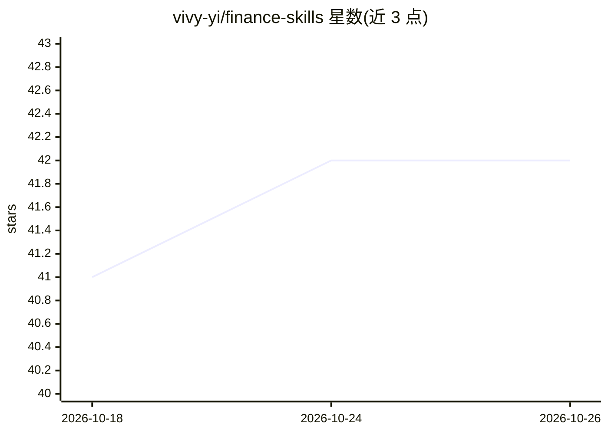

# vivy-yi/finance-skills

⭐ 42 · HTML · MIT · 推送 2026-06-14 · [GitHub](https://github.com/vivy-yi/finance-skills) · [官网](https://vivy-yi.github.io/finance-skills/) · 个人维护 · 中文 README

**面向 AI Agent 的 CFO 财务职能 Skill 体系（34 场景 × 152 Skill）**

一套以 Markdown（SKILL.md + YAML frontmatter）格式组织的财务智能体技能与知识库：34 个财务场景（战略级 17 + 运营级 17），每场景含 Master Skill 与 3~6 个 Atomic Skill、判断框架/数据源清单/查询路径三个知识文件，共 152 个 SKILL.md 与 102 个 references 文件。通过软链接或 SOUL.md 配置加载到 Hermes Agent / OpenClaw 等 Claude 类框架，经冷启动流程配置 Connector 与阈值；9 类 Connector 覆盖 SAP、Power BI、BlackLine、Bloomberg 等 L1~L5 系统。面向 CFO 及财务职能的 Agent 应用场景。

## 筛选速览

| 维度 | 判定 | 备注 |
|---|---|---|
| AI 角色 | `ai-knowledge` | 知识聚合/清单类 |
| 许可风险 | `permissive` | MIT |
| 部署形态 | `None` |  |
| 模型依赖 | — | README 未给出锁定关系 |
| 硬件要求 | — | 无带数字的原话,不猜 |
| 安装摩擦 | `low` | 无编译、无系统依赖或容器化 |
| 成熟度 | — | 结构信号不足 |

## 能力要点

- 34 个财务场景 × 152 个 SKILL.md（30 Master + 122 Atomic）
- 每场景附判断框架/数据源清单/查询路径三份知识后端文件
- 9 类 Connector 覆盖 SAP/Power BI/BlackLine/Bloomberg 等 L1~L5 系统
- 提供冷启动流程（连接器检测→公司配置→场景选择→阈值设置→持久化）

## 适用场景

- 让 Agent 执行内控测试、KPI 根因分析、IFRS 9 信用风险评估等财务任务
- 为 CFO 工作流（控制/分析/决策/披露）加载可分发的场景技能
- 与同源的 Greater China Legal Skill 体系在同一 Agent 中配合使用

## 场景标签

`Agent 框架` · 领域:Agent 开发

## 证据(README 行号)

> L13: Finance Skills 是一套面向 AI Agent 的**财务职能 Skill 系统**。每个 Skill 对应一个财务场景中的具体任务，Agent 加载后可以自主完成从数据读取、判断到输出的完整工作流。
> L200: - **Agent 框架**：Hermes Agent / OpenClaw
> L203: - **系统集成**：MCP（Model Context Protocol）Connector

## 星数曲线

2026-10-18 41 → 2026-10-26 42（+1）

---
*卡片 v1 · prompt 1.4 · 生成 2026-10-25 · 置信度 high · 依据 README sha `b2740420889b` · [字段定义](../../DATASET.md)*
