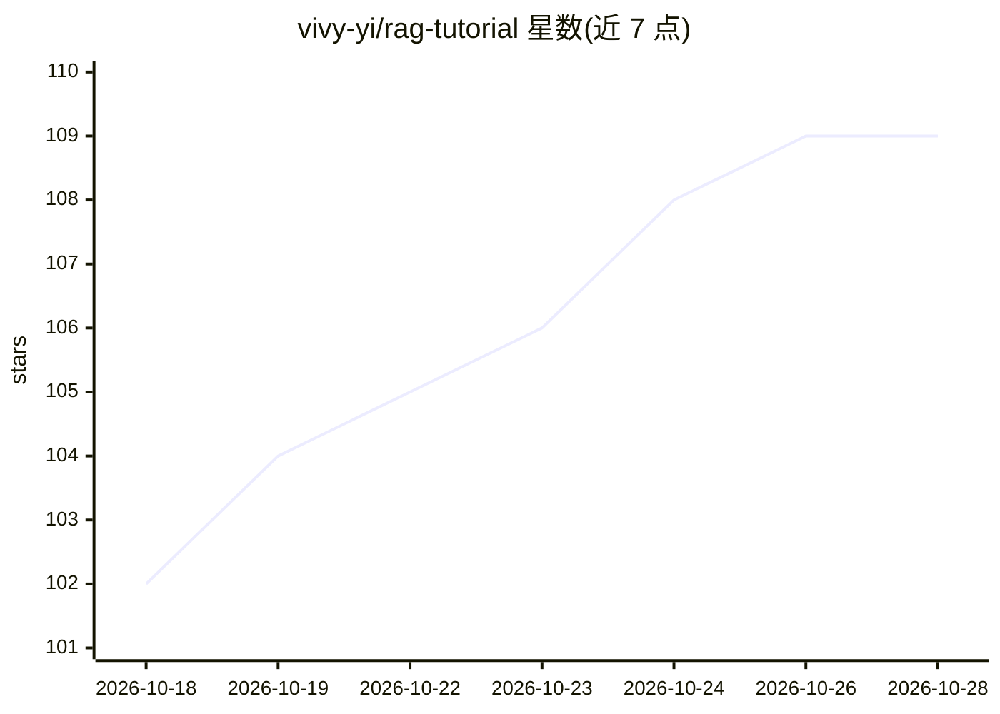

# vivy-yi/rag-tutorial

⭐ 109 · Jupyter Notebook · MIT · 推送 2026-02-11 · [GitHub](https://github.com/vivy-yi/rag-tutorial) · [官网](https://vivy-yi.github.io/rag-tutorial/) · 个人维护 · 中文 README

**面向中文学习者的 RAG 技术系统化教程（4模块/20章/17 Notebook）**

从基础概念到生产部署的中文 RAG 教程仓库：4 个模块、20 章约 50 万字文档，配 17 个 Jupyter Notebooks 与 6 个可运行的实战案例项目（智能客服、文档问答、研究 Agent、GraphRAG、多模态问答、企业级平台）。技术栈覆盖 LangChain、LlamaIndex、ChromaDB/Pinecone/Weaviate、Ollama 本地模型等，含 HyDE、Self-RAG、CRAG、GraphRAG、Deep Research 等进阶内容。学习方式包括 GitHub Pages 在线阅读、本地 Notebooks 与克隆仓库运行案例。

## 筛选速览

| 维度 | 判定 | 备注 |
|---|---|---|
| AI 角色 | `ai-knowledge` | 知识聚合/清单类 |
| 许可风险 | `permissive` | MIT |
| 部署形态 | `library` | 以包/库形式分发 |
| 模型依赖 | — | README 未给出锁定关系 |
| 硬件要求 | — | 无带数字的原话,不猜 |
| 安装摩擦 | `low` | 无编译、无系统依赖或容器化 |
| 成熟度 | — | 结构信号不足 |

## 能力要点

- 4 模块 20 章约 50 万字文档 + 89 张技术图表
- 17 个 Jupyter Notebooks 与 30+ 练习题（附参考答案）
- 6 个可运行企业级案例（含 FastAPI/JWT/Redis 的平台案例）
- 覆盖 GraphRAG、多模态 RAG、Deep Research Agent 等进阶主题

## 适用场景

- 系统学习 RAG 从入门到生产部署的完整路径
- 通过 Notebook 交互式练习分块、检索、重排序等技术
- 参考 6 个实战案例源码构建自己的问答/客服系统

## 场景标签

`教程课程` `RAG` · 领域:知识与检索

## 证据(README 行号)

> L21: - 📚 **系统化学习路径**: 4个模块，20章内容，从入门到精通
> L22: - 💻 **17个Jupyter Notebooks**: 交互式学习环境，即学即练

## 星数曲线

2026-10-18 102 → 2026-10-28 109（+7）

---
*卡片 v1 · prompt 1.4 · 生成 2026-10-23 · 置信度 high · 依据 README sha `1705edd0d9bd` · [字段定义](../../DATASET.md)*
