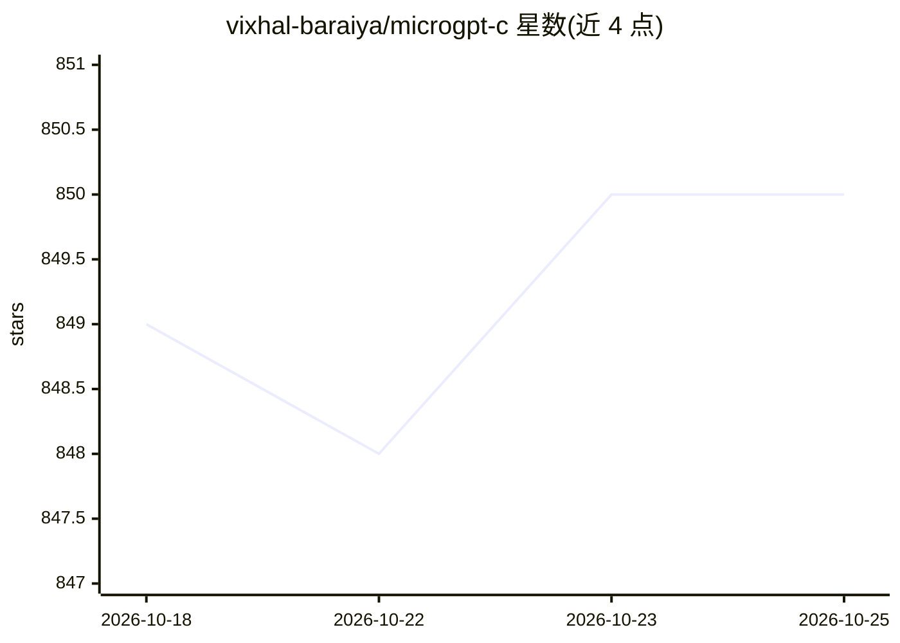

# vixhal-baraiya/microgpt-c

⭐ 850 · C · MIT · 推送 2026-08-17 · [GitHub](https://github.com/vixhal-baraiya/microgpt-c) · 个人维护

**单文件纯 C 实现的字符级 GPT 训练与推理库**

以一个 C 文件实现字符级 transformer，包含前向传播、反向传播、Adam 优化器与采样，除 libc 外无任何依赖。可在约 32k 个人名上数秒完成训练并生成新人名；模型 4192 参数，训练与推理使用分离的前向路径。通过 make 构建，支持 macOS、Linux、Windows (MSYS2)，ARM64 NEON 与 x86-64 AVX2 由 Makefile 自动选择编译选项，也可对任意每行一条的语料运行。

## 筛选速览

| 维度 | 判定 | 备注 |
|---|---|---|
| AI 角色 | `ai-native` | 本体是模型或模型工具 |
| 许可风险 | `permissive` | MIT |
| 部署形态 | `None` |  |
| 模型依赖 | — | README 未给出锁定关系 |
| 硬件要求 | — | 无带数字的原话,不猜 |
| 安装摩擦 | `low` | 无编译、无系统依赖或容器化 |
| 成熟度 | — | 结构信号不足 |

## 能力要点

- 前向、反向传播、Adam 与采样全部在一个 C 文件中，仅依赖 libc
- 在 ~32k 人名数据集上数秒完成训练并生成新人名
- ARM64 NEON 与 x86-64 AVX2 支持，Makefile 按主机选择编译选项
- 训练与推理分离的前向路径（gpt_forward / gpt_forward_infer）

## 适用场景

- 学习 GPT 训练与反向传播的最小实现结构
- 在无依赖环境中快速训练小型字符级语言模型
- 作为纯 C 深度学习教学/实验基础代码

## 场景标签

`模型训练` `教程课程` · 领域:学习与行业

## 证据(README 行号)

> L3: The most atomic way to train and inference a GPT in pure, dependency-free C.
> L5: A character-level transformer with forward pass, backprop, Adam and
> L6: sampling, in one C file with nothing beyond libc. It trains on ~32k names

## 星数曲线

2026-10-18 849 → 2026-10-25 850（+1）

---
*卡片 v1 · prompt 1.4 · 生成 2026-10-21 · 置信度 high · 依据 README sha `a1855f8dccad` · [字段定义](../../DATASET.md)*
