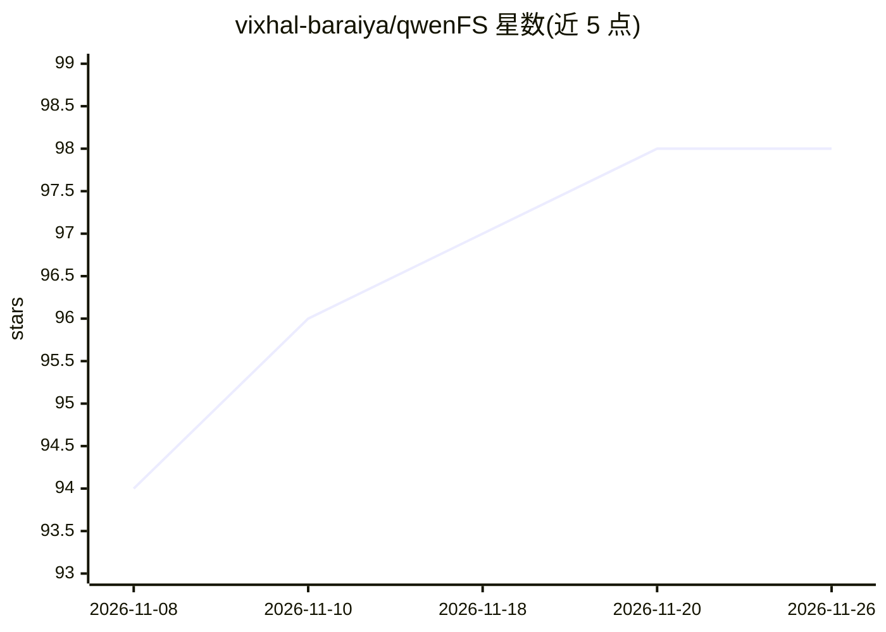

# vixhal-baraiya/qwenFS

⭐ 98 · Python · MIT · 推送 2026-11-04 · [GitHub](https://github.com/vixhal-baraiya/qwenFS) · 个人维护

**把文件系统直接编译进 Qwen3.5-2B 权重的实验性模型**

实验性研究项目：在 Qwen3.5-2B 前插入 8 层非学习的 transformer 层，将一个文件系统（保存/读取/追加/链接/搜索，128 个文件上限）直接构造进模型权重。模型通过普通工具调用操作自己的文件，解析、查表、强制 token 均由权重完成；外部仅保留聊天循环、磁盘分页和状态监视面板。支持磁盘镜像持久化与会话间挂载。约 20 tokens/s（MPS），16 GB 内存可用。提供 scenario eval 与脚本化测试。

## 筛选速览

| 维度 | 判定 | 备注 |
|---|---|---|
| AI 角色 | `ai-native` | 本体是模型或模型工具 |
| 许可风险 | `permissive` | MIT |
| 部署形态 | `None` |  |
| 模型依赖 | — | README 未给出锁定关系 |
| 硬件要求 | — | 无带数字的原话,不猜 |
| 安装摩擦 | `low` | 无编译、无系统依赖或容器化 |
| 成熟度 | `idea` | |

## 能力要点

- 文件系统以 8 层构造权重嵌入模型，无任何学习参数
- 9 个文件工具：写/读/追加/列目录/链接/反链/搜索
- 磁盘镜像持久化：新会话挂载旧文件，按需分页载入
- 强制 token 经逐 token 校验（脚本会话 6308/6308）

## 适用场景

- 研究把确定性数据结构编译进 LLM 权重的可行性
- 让 2B 模型在自身状态内维护小型持久化文件库
- 考察模型侧文件系统与工具调用的交互行为

## 场景标签

 · 领域:AI 研究/模型架构

## 证据(README 行号)

> L3: **qwenFS is an experimental model: Qwen3.5-2B with a filesystem compiled and inserted directly
> L5: filesystem is 8 transformer layers in front of Qwen's own 24, and none of their weights are
> L6: learned: every one is set by construction. Qwen saves, reads, organizes and links its own files

## 星数曲线

2026-11-08 94 → 2026-11-26 98（+4）

---
*卡片 v1 · prompt 1.4 · 生成 2026-11-17 · 置信度 high · 依据 README sha `010e54b24e3c` · [字段定义](../../DATASET.md)*
