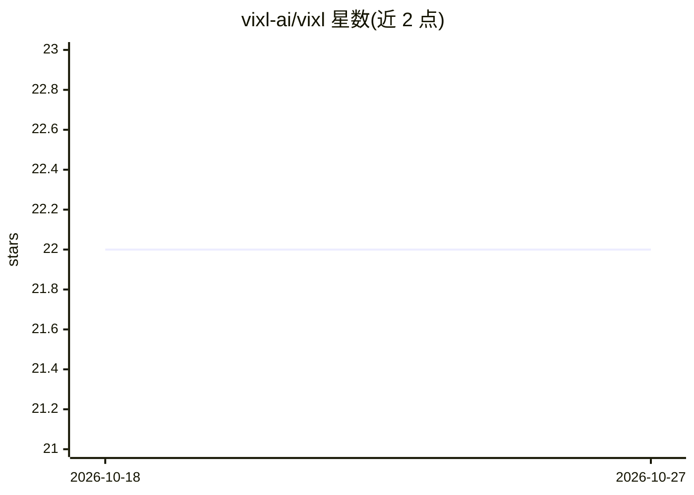

# vixl-ai/vixl

⭐ 22 · TypeScript · MIT · 推送 2026-10-26 · [GitHub](https://github.com/vixl-ai/vixl) · [官网](https://vixl.app/) · 组织维护

**本地优先、自带 API key 的桌面编程 agent**

基于 Tauri/Vue.js/TypeScript/Rust 构建的本地优先桌面编程 agent 应用，定位为 Cursor、Antigravity 与 VS Code agents 的替代。采用自带 key（BYOK）模式，无账户无订阅；支持接入任意目录服务商或本地主机，提供四种聊天模式、持久化计划、MCP 客户端与工作台。示例中先规划再交给较便宜的子 agent 执行实现，成本约为单次长对话的 30%。通过下载最新发布版安装。

## 筛选速览

| 维度 | 判定 | 备注 |
|---|---|---|
| AI 角色 | `ai-native` | 本体是模型或模型工具 |
| 许可风险 | `permissive` | MIT |
| 部署形态 | `None` |  |
| 模型依赖 | — | README 未给出锁定关系 |
| 硬件要求 | — | 无带数字的原话,不猜 |
| 安装摩擦 | `low` | 无编译、无系统依赖或容器化 |
| 成熟度 | — | 结构信号不足 |

## 能力要点

- BYOK 模式，无账户与订阅
- 支持任意目录服务商或本地主机接入
- 四种聊天模式、持久化计划与 MCP 客户端
- 规划与实现分离的子 agent 执行方式

## 适用场景

- 在桌面端用自带 API key 的 agent 辅助编程
- 用本地模型运行编程 agent，代码不出本机
- 通过 MCP 连接外部工具扩展 agent 能力

## 场景标签

`编码 Agent` · 领域:编码与开发

## 证据(README 行号)

> L40: **Vixl is a local-first, bring-your-own-key alternative to Cursor, Antigravity, and VS Code agents.** There is no V
> L42: Use any catalog provider or a local host. Four chat modes, durable plans, MCP, and a workbench. In a worked example

## 星数曲线

2026-10-18 22 → 2026-10-27 22（+0）

---
*卡片 v1 · prompt 1.4 · 生成 2026-10-27 · 置信度 mid · 依据 README sha `b2e9746b180e` · [字段定义](../../DATASET.md)*
