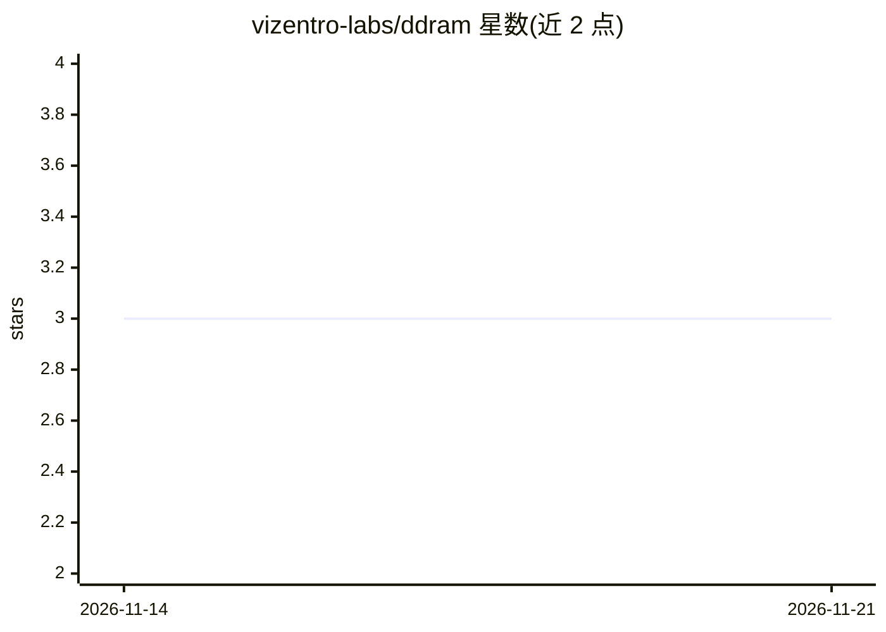

# vizentro-labs/ddram

⭐ 3 · Rust · Apache-2.0 · 推送 2026-10-13 · [GitHub](https://github.com/vizentro-labs/ddram) · 组织维护

**用 NVMe/SSD 扩展 RAM 的跨平台分层内存库，面向 GPU/AI/游戏负载**

Rust 编写、带 C API 的用户态分层内存库：给进程一个大于物理 RAM 的内存区域，热块驻留在固定 RAM 预算内，冷块放在 SSD 上，数据按需、预读或应用显式指令在两层间搬移。支持透明指针与 pin/prefetch/advise 两种模式，提供计划驱动分页、O_DIRECT 直 I/O、基于 NVMe SMART 健康日志的写入限制，RAM 区可注册到 CUDA/cuFile/Metal/DirectStorage 以 DMA 上传。跨 Linux/macOS/Windows，附 CLI 与基准报告。GPU 路径已暴露但未在硬件上验证。

## 筛选速览

| 维度 | 判定 | 备注 |
|---|---|---|
| AI 角色 | `ai-ecosystem` | LLM/agent 周边工具 |
| 许可风险 | `permissive` | Apache-2.0 |
| 部署形态 | `None` |  |
| 模型依赖 | — | README 未给出锁定关系 |
| 硬件要求 | — | 无带数字的原话,不猜 |
| 安装摩擦 | `high` | 编译与系统依赖俱全 |
| 成熟度 | `idea` | |

## 能力要点

- 透明指针模式与显式 pin/prefetch/advise 两种使用方式
- 计划驱动分页：按声明访问顺序预取并按 Belady 规则逐出
- 固定 RAM 上限，直 I/O 绕过页缓存，抗扫描策略
- 可注册 CUDA/cuFile/Metal/DirectStorage 实现固定块 DMA 上传

## 适用场景

- LLM 权重与 KV 缓存超出内存预算时分层存储
- 游戏资产与纹理的流式加载
- 扩散模型与训练数据集的内存扩展
- 通过 LD_PRELOAD 让现有程序在更大内存区域上运行

## 场景标签

 · 领域:系统基础设施/内存分层

## 证据(README 行号)

> L5: `ddram` is a userspace tiered-memory library written in Rust, with a C API.
> L9: asks (pin, prefetch, advise). It targets the large datasets behind GPU
> L38: * **GPU-ready.** The RAM arena is one fixed range that can be registered once

## 星数曲线

2026-11-14 3 → 2026-11-21 3（+0）

---
*卡片 v1 · prompt 1.4 · 生成 2026-11-21 · 置信度 high · 依据 README sha `48b6fd0cb6c8` · [字段定义](../../DATASET.md)*
