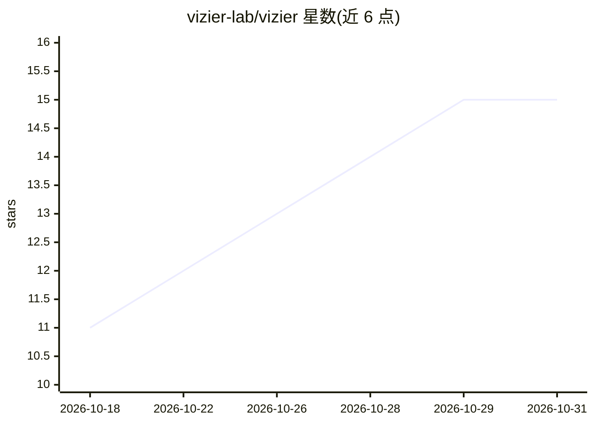

# vizier-lab/vizier

⭐ 15 · Rust · MIT · 推送 2026-10-30 · [GitHub](https://github.com/vizier-lab/vizier) · [官网](https://www.vizier.rs/) · 组织维护

**自托管的 Rust 多 AI agent 框架：单二进制运行多身份 agent**

Rust 实现的单二进制 AI agent 框架，并发运行多个 agent，每个 agent 拥有独立的 provider、工具、记忆与身份，通过 Discord、Telegram、REST、WebSocket 与内置 React WebUI 暴露。存储为内嵌 SQLite，无需外部服务。支持 29 个 provider（含 Ollama、OpenAI、Anthropic 等），长期记忆为磁盘上的 markdown 加链接图与语义搜索；提供 shell/沙箱工具、技能包、定时反思（dream cycle）、上下文检查点与多用户权限。安装支持 curl 脚本、cargo 或 Docker。

## 筛选速览

| 维度 | 判定 | 备注 |
|---|---|---|
| AI 角色 | `ai-ecosystem` | LLM/agent 周边工具 |
| 许可风险 | `permissive` | MIT |
| 部署形态 | `self-host` | docker 或自建部署 |
| 模型依赖 | local-ok | 支持本地模型 |
| 硬件要求 | — | 无带数字的原话,不猜 |
| 安装摩擦 | `low` | 无编译、无系统依赖或容器化 |
| 成熟度 | — | 结构信号不足 |

## 能力要点

- 单二进制并发运行多 agent，各配独立 provider/工具/记忆/身份
- 29 个 provider 含 Ollama/llama.cpp/OpenAI/Anthropic 及 OpenAI 兼容自定义端点
- markdown 磁盘长期记忆 + 链接图 + 每 agent 嵌入模型语义搜索
- 多通道暴露（Discord/Telegram/REST/WebSocket/WebUI），内嵌 SQLite 无外部依赖

## 适用场景

- 自托管一个长期记忆的个人 AI 助手并通过多平台对话
- 在同一实例上运行多个不同身份与配置的 agent
- 通过 REST/WebSocket API 将 agent 接入自己的应用

## 场景标签

`Agent 框架` `多智能体` `Agent 记忆` `AI 助手` · 领域:Agent 开发

## 证据(README 行号)

> L6: Vizier is a Rust-based AI agent framework: a single binary that runs multiple concurrent AI agents — each with its o
> L14: - **29 providers** — Ollama, llama.cpp, OpenAI, Anthropic, Gemini, DeepSeek, OpenRouter, Xiaomi MiMo, Groq, Mistral

## 星数曲线

2026-10-18 11 → 2026-10-31 15（+4）

---
*卡片 v1 · prompt 1.4 · 生成 2026-10-30 · 置信度 mid · 依据 README sha `025ac0f45f64` · [字段定义](../../DATASET.md)*
