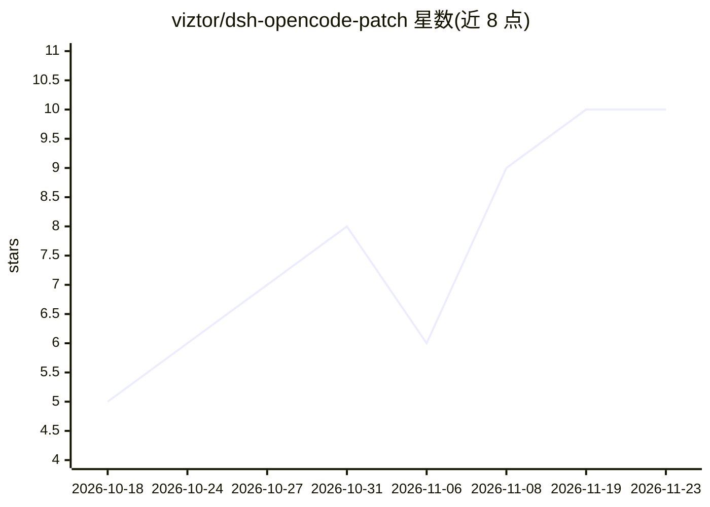

# viztor/dsh-opencode-patch

⭐ 10 · TypeScript · MIT · 推送 2026-11-22 · [GitHub](https://github.com/viztor/dsh-opencode-patch) · 个人维护

**DSH 插件：让 OpenCode Zen/Go 模型在 DeepSeek Harness 中正常工作**

dsh-opencode-patch 是 DeepSeek Harness（DSH）的宿主插件，修复 DSH 直连 OpenCode 网关时请求被拒的问题：恢复 User-Agent 与 x-opencode-client 等网关来源头、为每轮生成确定性 ses_ 会话 ID 并保持跨轮/子代理亲和、为免费档注入 read/bash 工具 schema、按模型路由到四种 API 协议形态，并提供带名称/价格/上下文窗口的模型目录与配额计量。仅拦截 opencode 与 opencode-go 两条路由，其他提供商流量原样通过。以 npm 包发布，安装到 DSH Web profile 使用。

## 筛选速览

| 维度 | 判定 | 备注 |
|---|---|---|
| AI 角色 | `ai-ecosystem` | LLM/agent 周边工具 |
| 许可风险 | `permissive` | MIT |
| 部署形态 | `library` | 以包/库形式分发 |
| 模型依赖 | — | README 未给出锁定关系 |
| 硬件要求 | — | 无带数字的原话,不猜 |
| 安装摩擦 | `low` | 无编译、无系统依赖或容器化 |
| 成熟度 | — | 结构信号不足 |

## 能力要点

- 确定性 ses_ 会话哈希与跨轮/子代理 KV-cache 亲和
- 网关来源头恢复（User-Agent、x-opencode-client/project、父会话链）
- 按模型多协议路由：Responses/Messages/Chat Completions/Google 四种形态
- 双模式配额计量（Go 订阅配额环 / Zen 按量计费）

## 适用场景

- 在 DSH 中接入 OpenCode Zen/Go 免费档与付费模型
- 修复会话 ID 缺失导致的 400 与子代理上下文丢失
- 查看 OpenCode 模型的实时配额与花费

## 场景标签

`模型网关` · 领域:Agent 开发

## 证据(README 行号)

> L28: `dsh-opencode-patch` is a DeepSeek Harness host plugin that keeps **OpenCode Zen & Go** models working inside DSH. 
> L39: **What this does.** It serves the two OpenCode routes itself — `opencode` and `opencode-go`, every model on the pro
> L114: **One route per plane, every protocol on it.** The plugin serves `opencode` (Zen) and `opencode-go` (Go) through i

## 星数曲线

2026-10-18 5 → 2026-11-23 10（+5）

---
*卡片 v1 · prompt 1.4 · 生成 2026-11-19 · 置信度 high · 依据 README sha `74a514ba1683` · [字段定义](../../DATASET.md)*
