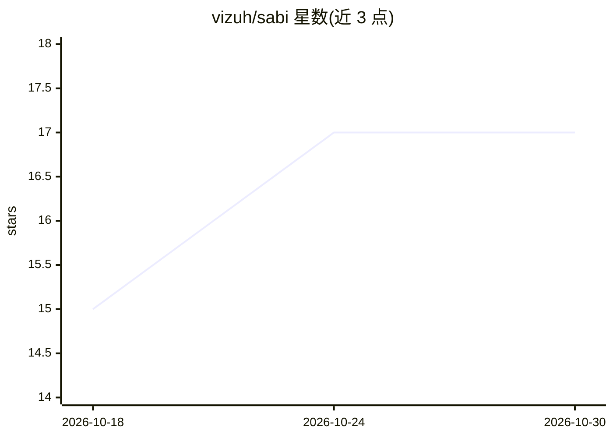

# vizuh/sabi

⭐ 17 · TypeScript · MIT · 推送 2026-09-30 · [GitHub](https://github.com/vizuh/sabi) · [官网](https://www.npmjs.com/package/@vizuh/sabi) · 个人维护 · 中文 README

**编码 agent 的逐轮自适应推理路由层：按轮选模型与提供商**

位于编码 harness 与模型之间的路由层：harness 保留自身循环、工具与审批，Sabi 依据轨迹证据（工具调用、失败、上下文压力、提供商状态）为每个推理轮或任务转移选择模型与提供商。产品含两个家族：推理适配器（Command Code 进程内 mod 与本地 OpenAI 兼容代理）与控制器适配器（Claude Code/Codex/OpenCode 等的 continue/delegate/spawn 钩子）。提供本地仪表盘、路由回执、拒绝处理与零成本影子 QA。仅重写 model 字段的借用认证路径不持有凭证。

## 筛选速览

| 维度 | 判定 | 备注 |
|---|---|---|
| AI 角色 | `ai-ecosystem` | LLM/agent 周边工具 |
| 许可风险 | `permissive` | MIT |
| 部署形态 | `library` | 以包/库形式分发 |
| 模型依赖 | local-ok | 支持本地模型 |
| 硬件要求 | — | 无带数字的原话,不猜 |
| 安装摩擦 | `low` | 无编译、无系统依赖或容器化 |
| 成熟度 | — | 结构信号不足 |

## 能力要点

- 按轮（而非按任务）选择模型档位与提供商
- 本地 OpenAI 兼容代理（127.0.0.1:8787/v1）支持 BYOK（OpenRouter/Ollama 等）
- Claude Code/Codex 控制器钩子：受限 continue/delegate/spawn，不写入密钥或模型覆盖
- 每轮记录路由回执：计划档位、实际服务模型与差异原因；本地仪表盘展示成功率/延迟/成本

## 适用场景

- 让编码 agent 按轨迹证据逐轮切换便宜/中档/强档模型
- 用自己的 OpenRouter/Ollama 凭证经本地代理做模型路由
- 在多个 harness 会话间协调委托与派生任务

## 场景标签

`模型网关` `LLM 可观测性` · 领域:Agent 开发

## 证据(README 行号)

> L11: Sabi sits between a coding harness and the models it can call. The harness keeps its own loop,
> L16: Sabi is a host-agnostic routing layer, not another agent harness or editor. Adapters are optional bridges to the ex
> L108: 1. **Inference adapters.** Command Code's in-process mod and the local OpenAI-compatible proxy

## 星数曲线

2026-10-18 15 → 2026-10-30 17（+2）

---
*卡片 v1 · prompt 1.4 · 生成 2026-10-29 · 置信度 high · 依据 README sha `ac06e8ed4953` · [字段定义](../../DATASET.md)*
