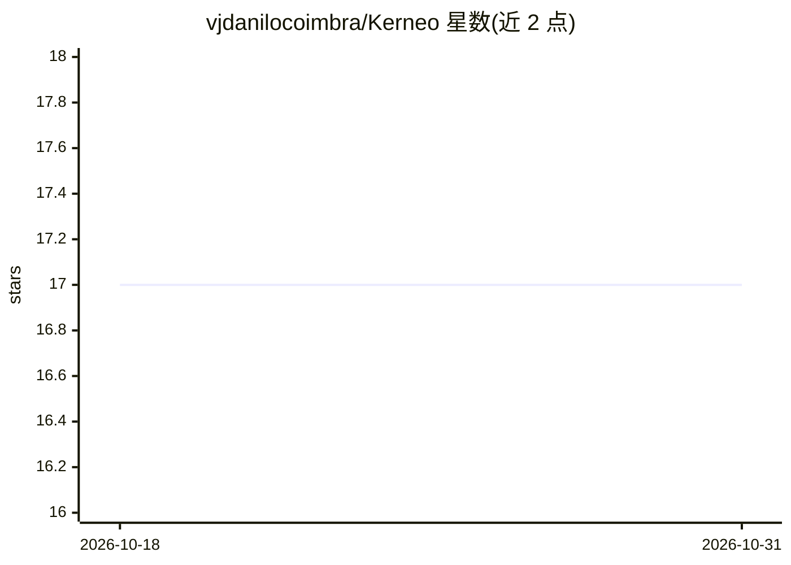

# vjdanilocoimbra/Kerneo

⭐ 17 · JavaScript · MIT · 推送 2026-05-05 · [GitHub](https://github.com/vjdanilocoimbra/Kerneo) · [官网](https://vjdanilocoimbra.github.io/ia/) · 个人维护

**运行在本机的葡语自进化 AI 助手：对话创建技能并操作电脑**

用 Node.js 编写、本地运行的 AI 编排助手，面向讲葡萄牙语的个人用户。核心机制：用户用自然语言请求时，可通过 skill_create 动态生成真实 JavaScript 技能文件（存于 src/tools/user-tools/），可审查、编辑、git 管理与分享；内置 15 个工具（打开程序、浏览器、搜索、文件读写、记忆操作等）与技能分享/安装市场工具。记忆分 Facts/History/Sessions 三层存于本地 SQLite。支持 8 个 LLM 提供商及自动 fallback，含 Ollama 离线模式；提供 PT-BR 语音输入输出。安装提供 Windows 一键脚本与手动路径，需 Node.js 20+。

## 筛选速览

| 维度 | 判定 | 备注 |
|---|---|---|
| AI 角色 | `ai-native` | 本体是模型或模型工具 |
| 许可风险 | `permissive` | MIT |
| 部署形态 | `desktop` | 安装包/桌面程序 |
| 模型依赖 | local-ok | 支持本地模型 |
| 硬件要求 | — | 无带数字的原话,不猜 |
| 安装摩擦 | `medium` | 含编译或系统依赖之一 |
| 成熟度 | — | 结构信号不足 |

## 能力要点

- skill_create 动态生成可审查/版本管理的 JavaScript 技能文件
- SQLite 本地三层记忆（Facts/History/Sessions），数据不出本机
- 8 个 LLM 提供商含 Ollama 离线模式，自动 fallback
- 15 个内置工具：系统操作、浏览器、Web 搜索、文件 IO、技能市场分享

## 适用场景

- 用葡语对话让 AI 打开程序、搜索、操作本机
- 让助手即时创建新技能（如控制音量）并复用
- 通过技能市场分享和安装他人技能
- 完全本地离线使用（配合 Ollama）

## 场景标签

`AI 助手` `GUI 自动化` · 领域:效率与自动化

## 证据(README 行号)

> L13: Kerneo é um **orquestrador de IA** que mora no **seu computador**.
> L32: 🤖 **Auto-evolução** — único orquestrador open source com `skill_create` dinâmico
> L35: 🔌 **8 providers LLM** — Groq (free), OpenAI, Anthropic, DeepSeek, Gemini, OpenRouter, Ollama (offline), Custom

## 星数曲线

2026-10-18 17 → 2026-10-31 17（+0）

---
*卡片 v1 · prompt 1.4 · 生成 2026-10-29 · 置信度 high · 依据 README sha `2b409361c986` · [字段定义](../../DATASET.md)*
