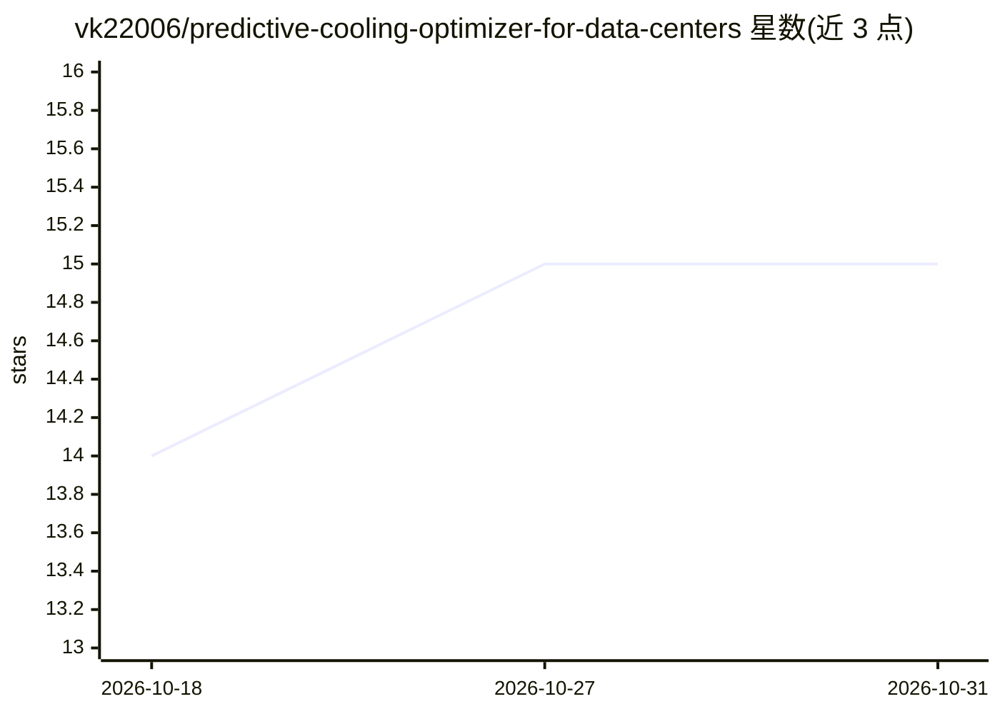

# vk22006/predictive-cooling-optimizer-for-data-centers

⭐ 15 · Jupyter Notebook · MIT · 推送 2026-10-24 · [GitHub](https://github.com/vk22006/predictive-cooling-optimizer-for-data-centers) · [官网](https://predictive-cooling-optimizer.vercel.app/) · 个人维护 · 中文 README

**预测数据中心冷却能耗与温度并优化冷水机调度的系统**

面向数据中心冷却能耗问题的预测优化系统：基于 13,615 条 HVAC 遥测记录做预处理与 46 维特征工程，训练两个 XGBoost 回归模型分别预测能耗（R²=0.9891）与温度，由 PredictiveCoolingOptimizer 引擎在温度安全约束下对候选流量执行能耗最小化策略。以 FastAPI 后端加 React 前端形式交付，本地运行需依次安装 Python 依赖、启动后端与前端。报告 11 项验证测试全部通过。

## 筛选速览

| 维度 | 判定 | 备注 |
|---|---|---|
| AI 角色 | `ai-native` | 本体是模型或模型工具 |
| 许可风险 | `permissive` | MIT |
| 部署形态 | `library` | 以包/库形式分发 |
| 模型依赖 | — | README 未给出锁定关系 |
| 硬件要求 | — | 无带数字的原话,不猜 |
| 安装摩擦 | `low` | 无编译、无系统依赖或容器化 |
| 成熟度 | — | 结构信号不足 |

## 能力要点

- 两个 XGBoost 模型：能耗预测 R²=0.9891、温度预测 ±1°C 容差内占 89.24%
- 13,615 条 HVAC 遥测记录的 IQR 去噪、归一化与时序保序划分
- 46 维特征工程（滞后、滚动统计、周期编码、交互项）
- FastAPI 后端 + React 19 前端的部署架构

## 适用场景

- 数据中心运维中提前预测温度以优化冷水机调度
- 在温度安全边界内降低冷却系统能耗
- 在本地跑通预测模型并查看交互式仪表盘

## 场景标签

`数据分析` · 领域:效率与自动化

## 证据(README 行号)

> L20: Two XGBoost regression models drive the core predictive engine:
> L27: The `PredictiveCoolingOptimizer` engine integrates both models, executing constraint-bounded temperature management

## 星数曲线

2026-10-18 14 → 2026-10-31 15（+1）

---
*卡片 v1 · prompt 1.4 · 生成 2026-10-30 · 置信度 high · 依据 README sha `6774b63907bf` · [字段定义](../../DATASET.md)*
