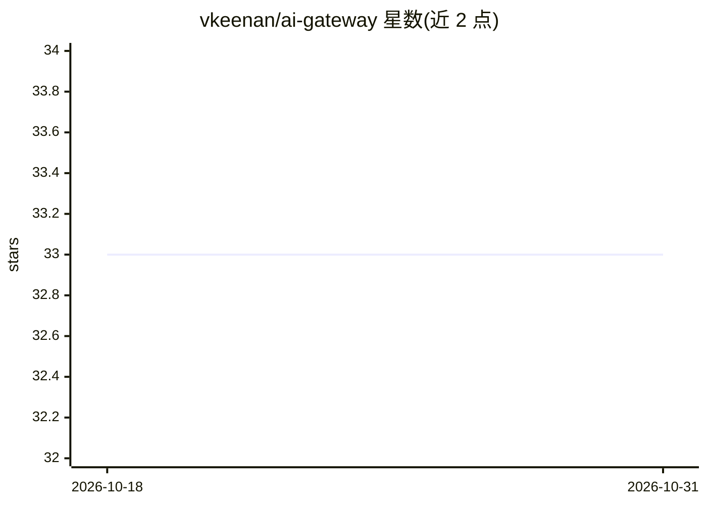

# vkeenan/ai-gateway

⭐ 33 · Apex · MIT · 推送 2026-09-13 · [GitHub](https://github.com/vkeenan/ai-gateway) · [官网](https://salesforcedevops.net) · 个人维护

**把 OpenAI API 接入 Salesforce 的提示工程网关**

Salesforce 平台上的开源方案：通过自定义对象 Prompt__c 存储参数化提示词，经 Flow 调用 OpenAI chat completions API（gpt-4/gpt-3.5-turbo），响应存入 PromptAnswer__c 对象。面向 Salesforce 管理员与开发者，提供提示词目录共享、Named Credential 安全存储 API key 与权限集控制。README 明确提示 Prompt__c/PromptAnswer__c 不支持加密，不应存储 PII。可通过 AppExchange 安装或部署到 scratch org 开发测试。

## 筛选速览

| 维度 | 判定 | 备注 |
|---|---|---|
| AI 角色 | `ai-ecosystem` | LLM/agent 周边工具 |
| 许可风险 | `permissive` | MIT |
| 部署形态 | `None` |  |
| 模型依赖 | — | README 未给出锁定关系 |
| 硬件要求 | — | 无带数字的原话,不猜 |
| 安装摩擦 | `low` | 无编译、无系统依赖或容器化 |
| 成熟度 | — | 结构信号不足 |

## 能力要点

- Prompt__c / PromptAnswer__c 自定义对象存储提示词与响应
- 通过 Flow 调用 OpenAI chat completions API
- Named Credential + 权限集管理 OpenAI API key 的访问
- 支持参数化零样本提示词并在用户间共享目录

## 适用场景

- Salesforce 团队共享和复用提示词模板
- 管理员为组织成员提供受控的 OpenAI 文本生成入口
- 作为组织试用 OpenAI API 的最小实现模板

## 场景标签

`提示工程` · 领域:Agent 开发

## 证据(README 行号)

> L13: `AI Gateway for Salesforce` is a novel, open-source solution that enables Salesforce users to employ the OpenAI API
> L33: 3. A Flow is executed that sends the prompt to OpenAI and waits for a response and prints it on the screen.

## 星数曲线

2026-10-18 33 → 2026-10-31 33（+0）

---
*卡片 v1 · prompt 1.4 · 生成 2026-10-25 · 置信度 high · 依据 README sha `6c20c4b6a8f8` · [字段定义](../../DATASET.md)*
