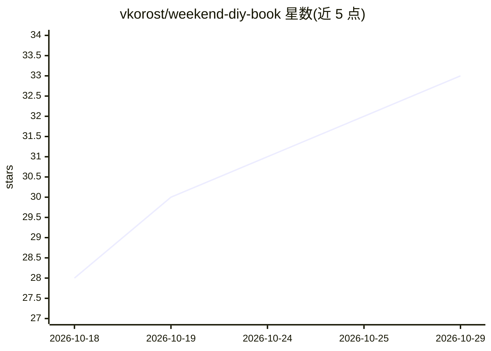

# vkorost/weekend-diy-book

⭐ 33 · Shell · CC0-1.0 · 推送 2026-08-15 · [GitHub](https://github.com/vkorost/weekend-diy-book) · 个人维护

**AI 一个周末写成的 Claude Code 进阶技术书，附自写指南**

一本由 Claude Code 通过多 agent 流水线在一个周末写成的技术书，面向已有数月日常使用经验的 Claude Code 用户，内容覆盖 agentic 编排、MCP 集成、CI/CD 自动化、提示词技巧、大型代码库策略、故障恢复与团队采用。免费提供 EPUB/PDF/Word 及 Markdown 版本，2026 年 7 月版已对照当前 CLI 与官方文档校验。仓库另含产出该书的 assignment 文件，用户可 fork 后替换主题自行生成一本书；重建需运行 build.sh，依赖 Pandoc 与 XeLaTeX。许可为 CC0 公共领域。

## 筛选速览

| 维度 | 判定 | 备注 |
|---|---|---|
| AI 角色 | `ai-knowledge` | 知识聚合/清单类 |
| 许可风险 | `viral` | CC0-1.0 |
| 部署形态 | `None` |  |
| 模型依赖 | — | README 未给出锁定关系 |
| 硬件要求 | — | 无带数字的原话,不猜 |
| 安装摩擦 | `low` | 无编译、无系统依赖或容器化 |
| 成熟度 | — | 结构信号不足 |

## 能力要点

- 整本书由 Claude Code 多 agent 流水线生成并经官方文档校验
- 免费提供 EPUB/PDF/Word/Markdown 四种格式
- 附 assignment 文件，可 fork 后替换主题生成自己的书
- build.sh 确定性重建，依赖 Pandoc 与 XeLaTeX

## 适用场景

- 进阶 Claude Code 用户系统提升 agentic 开发能力
- 在电纸书（Kindle/Kobo/reMarkable）上阅读技术书
- 复用 assignment 文件一个周末生成自己主题的书

## 场景标签

`教程课程` `AI 写作` · 领域:内容生成

## 证据(README 行号)

> L3: A technical book about Claude Code — written entirely by Claude Code in one weekend,
> L19: A book for experienced Claude Code users who want to get significantly better. It covers agentic orchestration, MCP
> L36: The most interesting file in this repo isn't the book — it's the assignment file.

## 星数曲线

2026-10-18 28 → 2026-10-29 33（+5）

---
*卡片 v1 · prompt 1.4 · 生成 2026-10-25 · 置信度 high · 依据 README sha `550d4e9fcd25` · [字段定义](../../DATASET.md)*
