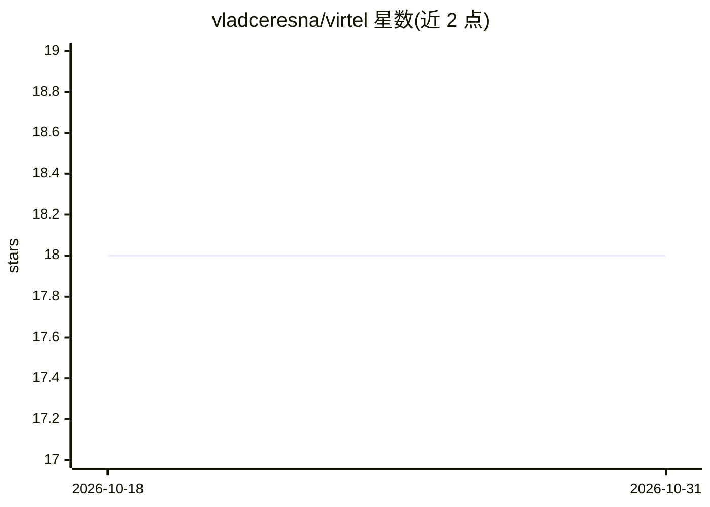

# vladceresna/virtel

⭐ 18 · Rust · AGPL-3.0 · 推送 2025-12-22 · [GitHub](https://github.com/vladceresna/virtel) · [官网](https://virtel.netlify.app/) · 个人维护

**跨平台应用执行环境：浏览器+OS 混合形态，运行超轻量 Wren 应用**

用 Rust 编写核心引擎、Skia/Taffy/Winit 构建界面、Wren VM 运行应用的跨平台执行环境，定位介于浏览器与传统操作系统之间：应用在隔离沙箱运行、本地存储、可离线执行。平台层统一提供内置依赖，使应用体积以字节/千字节计。配套 Steps 编程语言，计划支持其他语言转译到 Wren 字节码。已支持 Windows/Linux/Android，macOS/iOS 未支持；提供官网下载，源码构建需 JDK 21+、Android Studio 与 Rust 工具链。项目自称处于早期阶段，正在寻找共同创始人。README 未描述 AI 相关功能。

## 筛选速览

| 维度 | 判定 | 备注 |
|---|---|---|
| AI 角色 | `ai-enhanced` | 去掉 AI 部分产品仍成立 |
| 许可风险 | `viral` | AGPL-3.0 |
| 部署形态 | `None` |  |
| 模型依赖 | — | README 未给出锁定关系 |
| 硬件要求 | — | 无带数字的原话,不猜 |
| 安装摩擦 | `medium` | 含编译或系统依赖之一 |
| 成熟度 | `idea` | |

## 能力要点

- 应用在隔离沙箱运行并本地存储，支持离线与即时启动
- Wren VM 运行应用，配套 Steps 语言
- 平台级统一内置依赖，应用体积以字节/千字节计
- 已支持 Windows/Linux/Android 平台

## 适用场景

- 在多设备上运行同一份超轻量应用文件
- 希望应用完全本地化存储与离线运行
- 用 Wren/Steps 语言编写跨平台小应用

## 场景标签

 · 领域:跨平台应用运行时/开发工具

## 证据(README 行号)

> L11: Virtel is a fundamentally new type of application environment, conceptualized as a hybrid between a web browser and
> L32: * **Applications:** Run on Wren VM in the **Wren** language.

## 星数曲线

2026-10-18 18 → 2026-10-31 18（+0）

---
*卡片 v1 · prompt 1.4 · 生成 2026-10-29 · 置信度 low · 依据 README sha `7e895964f910` · [字段定义](../../DATASET.md)*
