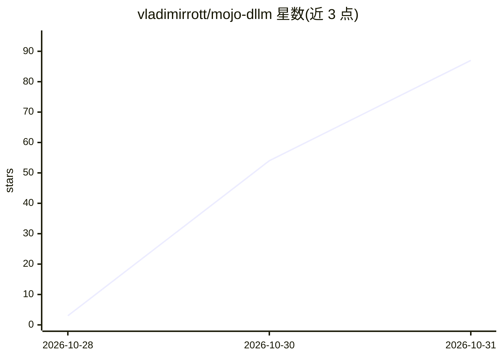

# vladimirrott/mojo-dllm

⭐ 87 · Mojo · Apache-2.0 · 推送 2026-10-29 · [GitHub](https://github.com/vladimirrott/mojo-dllm) · [官网](https://vladimirrott.github.io/mojo-dllm/) · 个人维护

**Mojo 编写的扩散语言模型本地推理运行时（LLaDA/Dream）**

纯 Mojo 实现的扩散语言模型（LLaDA-8B、Dream-7B）本地推理工具：从量化 GGUF 文件加载权重，在 CPU（AVX2）或 NVIDIA GPU（int8 tensor core，计算能力 8.0+）上运行去噪循环生成文本，运行时无需 Python。GGUF 读取、tokenizer、量化 GEMM、GPU kernel 与采样器均由 Mojo 编写。面向在本地机器上运行扩散语言模型的开发者，README 给出 CPU/GPU 基准并附 llama.cpp、diffuse-cpp 对比数据，且含对 llama.cpp 的 logits/token 正确性校验。限制：需 Linux x86-64、AVX2、glibc 2.34+、约 6 GB 空闲内存；GPU 路径仅在 RTX 3050 Laptop 上测过。

## 筛选速览

| 维度 | 判定 | 备注 |
|---|---|---|
| AI 角色 | `ai-ecosystem` | LLM/agent 周边工具 |
| 许可风险 | `permissive` | Apache-2.0 |
| 部署形态 | `None` |  |
| 模型依赖 | — | README 未给出锁定关系 |
| 硬件要求 | — | 无带数字的原话,不猜 |
| 安装摩擦 | `medium` | 含编译或系统依赖之一 |
| 成熟度 | `idea` | |

## 能力要点

- 纯 Mojo 实现 GGUF 读取、tokenizer、量化 GEMM 与去噪循环，运行时无需 Python
- 支持 LLaDA-8B 与 Dream-7B，从 Q4_K/Q6_K 量化 GGUF 文件加载
- CPU（AVX-VNNI）与 NVIDIA GPU（int8 tensor core）双路径，--device 可指定
- 对 llama.cpp 做 logits/token 级正确性校验，基准表由 CI 校验的结果文件渲染

## 适用场景

- 在本地 CPU 或 NVIDIA GPU 上运行 LLaDA/Dream 扩散语言模型
- 离线环境（无 Python 运行时依赖）下体验扩散式文本生成
- 对比扩散语言模型在不同运行时上的吞吐与内存占用

## 场景标签

`推理引擎` · 领域:训练与推理

## 证据(README 行号)

> L21: mojo-dllm runs **LLaDA-8B** and **Dream-7B**, two diffusion language models,
> L22: from quantized GGUF files on your CPU or on an NVIDIA GPU. The GGUF reader,

## 星数曲线

2026-10-28 3 → 2026-10-31 87（+84）

---
*卡片 v1 · prompt 1.4 · 生成 2026-10-30 · 置信度 high · 依据 README sha `002c7b262764` · [字段定义](../../DATASET.md)*
