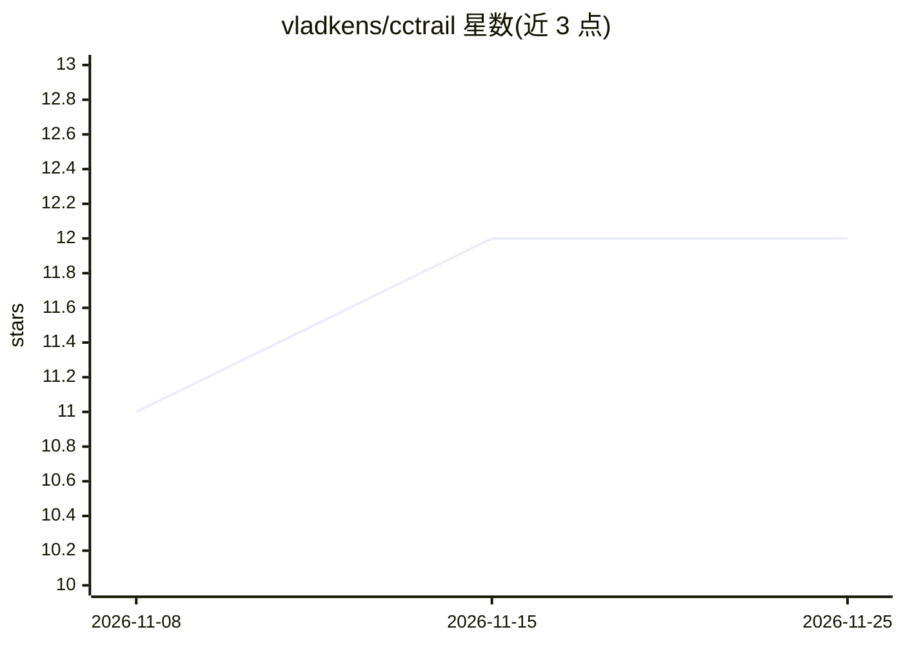

# vladkens/cctrail

⭐ 12 · Rust · MIT · 推送 2026-10-31 · [GitHub](https://github.com/vladkens/cctrail) · [官网](https://crates.io/crates/cctrail) · 个人维护

**给 AI 编码工具用户的本地用时/Token/费用统计 CLI**

Rust 编写的 CLI 工具，带 ratatui 交互式 TUI：读取 Claude Code、Codex、pi、fx 四种编码代理的本地历史文件，按项目统计活跃时间、Token 数与按当日 API 价格估算的成本。去重机制处理子代理/分叉重复计数，worktree 与 clone 归并为同一项目；支持日/周/月报表、JSON 输出、SQLite 导出导入，历史数据不出本机。提供 macOS/Linux/Windows 预编译包与 cargo 安装。

## 筛选速览

| 维度 | 判定 | 备注 |
|---|---|---|
| AI 角色 | `ai-ecosystem` | LLM/agent 周边工具 |
| 许可风险 | `permissive` | MIT |
| 部署形态 | `desktop` | 安装包/桌面程序 |
| 模型依赖 | — | README 未给出锁定关系 |
| 硬件要求 | — | 无带数字的原话,不猜 |
| 安装摩擦 | `low` | 无编译、无系统依赖或容器化 |
| 成熟度 | — | 结构信号不足 |

## 能力要点

- 按项目统计活跃时间（合并重叠窗口、并行项目分摊）
- 按当日 API 价格估算成本，价格来自 models.dev 每日刷新
- 子代理/分叉/多账户历史去重计数
- 交互式 TUI 与 JSON 文本报表，支持 SQLite export/import

## 适用场景

- 统计各项目在 Claude Code/Codex 上的活跃用时
- 对比订阅费与按 API 价格估算的用量成本
- 跨机器备份或迁移编码代理的历史用量数据

## 场景标签

`LLM 可观测性` · 领域:评测与运维

## 证据(README 行号)

> L10: `cctrail` reads the local history of Claude Code, Codex, pi and
> L27: - 📊 **Scriptable.** Reports by day, week or month, per project, group or model, and JSON.

## 星数曲线

2026-11-08 11 → 2026-11-25 12（+1）

---
*卡片 v1 · prompt 1.4 · 生成 2026-11-18 · 置信度 high · 依据 README sha `d8da39f50751` · [字段定义](../../DATASET.md)*
