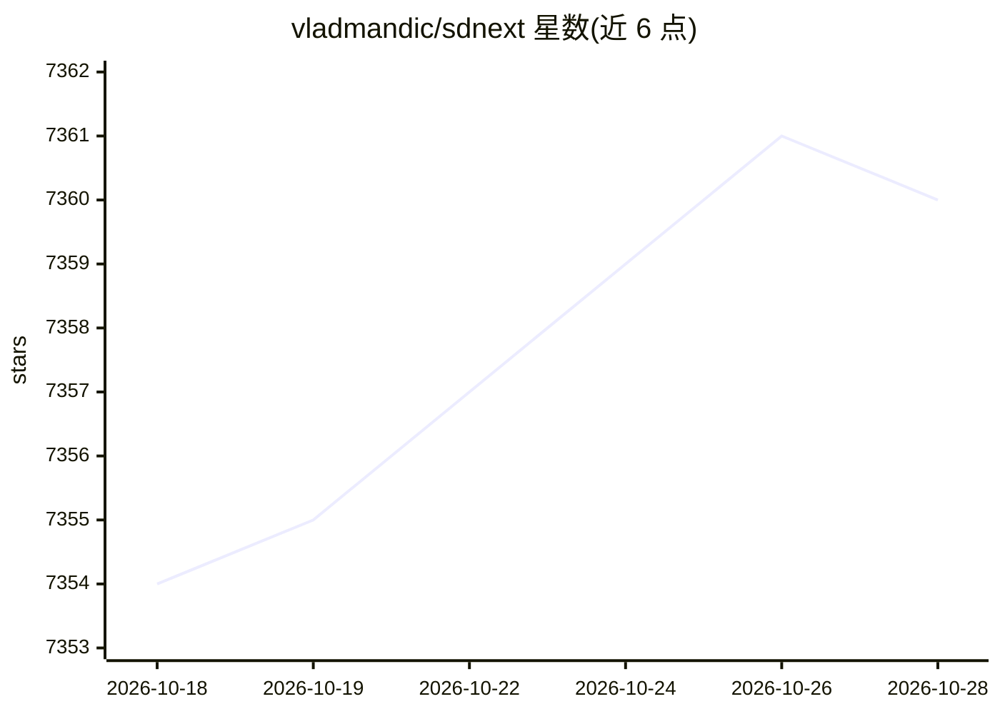

# vladmandic/sdnext

⭐ 7,362 · Python · Apache-2.0 · 推送 2026-10-28 · [GitHub](https://github.com/vladmandic/sdnext) · [官网](https://vladmandic.github.io/sdnext/) · 个人维护

**面向用户的扩散模型图像/视频生成与编辑 WebUI**

开源 Web 界面，用于以文本或图像生成/编辑图像与视频：支持文生图、图生图、文生视频、图生视频、内绘/外绘、放大、字幕标注、着色等处理，可用 LoRA、ControlNet、IP-Adapters 引导生成。运行于 NVIDIA/AMD/Intel/Apple Silicon/CPU 多种硬件，内置安装器管理依赖与更新，提供 Docker 容器配方与 Windows 一体化启动器 exe。代码基于 AUTOMATIC1111 的 Stable Diffusion WebUI 原始代码库构建，面向直接使用扩散模型产出的创作者。

## 筛选速览

| 维度 | 判定 | 备注 |
|---|---|---|
| AI 角色 | `ai-native` | 本体是模型或模型工具 |
| 许可风险 | `permissive` | Apache-2.0 |
| 部署形态 | `None` |  |
| 模型依赖 | — | README 未给出锁定关系 |
| 硬件要求 | `cpu-ok` | |
| 安装摩擦 | `medium` | 含编译或系统依赖之一 |
| 成熟度 | — | 结构信号不足 |

## 能力要点

- 文生图/图生图/文生视频/图生视频与内绘、外绘、放大、字幕等处理
- LoRA、ControlNet、IP-Adapters 引导生成，模型自动检测与参考列表自动下载
- 支持 NVIDIA CUDA、AMD ROCm/ZLUDA、Intel IPEX、OpenVINO、Apple MPS 与 CPU-only
- 内置安装器管理依赖与更新，提供 Docker 配方与 Windows exe 启动器

## 适用场景

- 用本地 GPU 生成和编辑图像或视频
- 为图像添加字幕、标签并做放大、插帧、着色处理
- 通过 ControlNet/LoRA 精细控制生成结果

## 场景标签

`图像生成` `视频生成` `图像视频处理` · 领域:内容生成

## 证据(README 行号)

> L5: SD.Next is a state-of-the-art open-source web interface for generating and editing images and video with a wide rang
> L56: - **Generate:** Text-to-image, image-to-image, text-to-video, and image-to-video.

## 星数曲线

2026-10-18 7,354 → 2026-10-28 7,360（+6）

---
*卡片 v1 · prompt 1.4 · 生成 2026-10-20 · 置信度 high · 依据 README sha `019d5139616e` · [字段定义](../../DATASET.md)*
