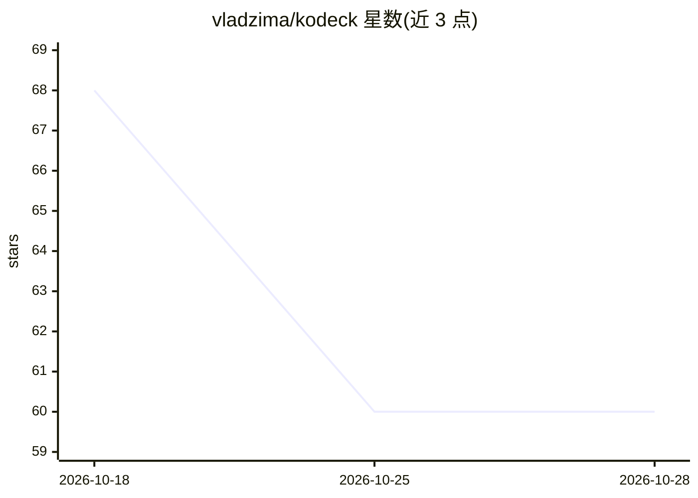

# vladzima/kodeck

⭐ 60 · TypeScript · MIT · 推送 2026-05-15 · [GitHub](https://github.com/vladzima/kodeck) · [官网](https://kodeck.dev) · 个人维护

**浏览器端开源 IDE：为 Claude Code 提供多项目工作区**

面向 Claude Code 用户的浏览器 IDE：提供多项目/多 worktree 工作区、流式聊天会话（含工具调用可视化与权限提示）、基于 xterm.js 的 PTY 终端、git worktree 管理与分支/PR 浏览，以及 CLAUDE.md、skills、hooks、MCP servers 配置浏览。会话与聊天历史可跨重启持久化，支持全局搜索；另提供基于 Tauri 的原生 macOS 桌面应用（可选）。要求 Node.js 22+ 与 Claude Code OAuth 认证。

## 筛选速览

| 维度 | 判定 | 备注 |
|---|---|---|
| AI 角色 | `ai-ecosystem` | LLM/agent 周边工具 |
| 许可风险 | `permissive` | MIT |
| 部署形态 | `library` | 以包/库形式分发 |
| 模型依赖 | locked-api |  |
| 硬件要求 | — | 无带数字的原话,不猜 |
| 安装摩擦 | `low` | 无编译、无系统依赖或容器化 |
| 成熟度 | — | 结构信号不足 |

## 能力要点

- 多项目工作区与 git worktree 创建/切换/推送管理
- 聊天会话含流式输出、工具调用可视化与权限提示
- xterm.js 全 PTY 终端与聊天并行使用
- 会话持久化与跨全部会话的搜索

## 适用场景

- 在浏览器中同时管理多个代码仓库与 worktree
- 以图形界面运行并观察 Claude Code 的聊天与工具调用
- 浏览各项目的 CLAUDE.md、skills、hooks 与 MCP 配置

## 场景标签

`编码 Agent` · 领域:编码与开发

## 证据(README 行号)

> L3: Open-source IDE for Claude Code. Multi-project workspace with chat, terminals, and git worktree management — all in 
> L16: - **Chat sessions** — streaming responses, tool call visualization, permission prompts, thinking indicators

## 星数曲线

2026-10-18 68 → 2026-10-28 60（-8）

---
*卡片 v1 · prompt 1.4 · 生成 2026-10-24 · 置信度 high · 依据 README sha `083e0b2e6968` · [字段定义](../../DATASET.md)*
