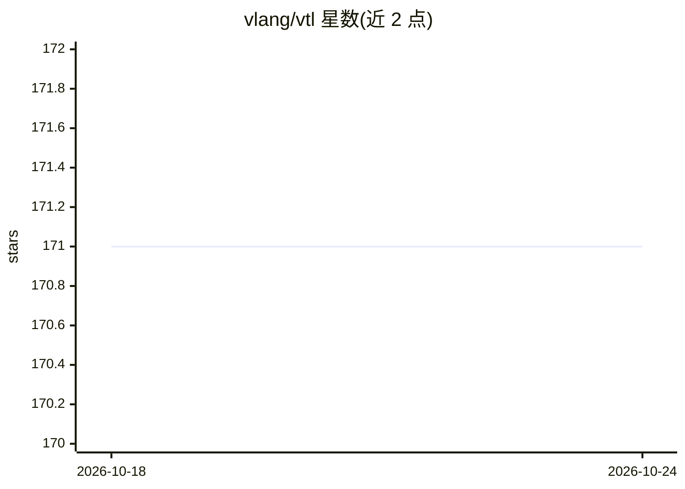

# vlang/vtl

⭐ 171 · V · MIT · 推送 2026-10-16 · [GitHub](https://github.com/vlang/vtl) · [官网](https://vlang.github.io/vtl) · 组织维护

**V 语言的张量库：ndarray、autograd 与神经网络训练**

纯 V 实现的张量与机器学习库：提供 n 维数组、切片/广播/einsum 等张量操作，反向模式自动微分，Sequential 式神经网络模块（Linear/Conv2D/LSTM/Attention）、多种损失与优化器，线性代数部分依赖 VSL（含 QR/LU/Cholesky/SVD 等）。计算路径支持 VSL 后端 CPU、可选的 CUDA 与 Vulkan（标注为实验性后端）。数据集加载含 MNIST/CIFAR-10/IMDB，支持 .npy/.npz 与 CSV 读写。通过 `v install vtl` 安装。

## 筛选速览

| 维度 | 判定 | 备注 |
|---|---|---|
| AI 角色 | `ai-native` | 本体是模型或模型工具 |
| 许可风险 | `permissive` | MIT |
| 部署形态 | `None` |  |
| 模型依赖 | — | README 未给出锁定关系 |
| 硬件要求 | — | 无带数字的原话,不猜 |
| 安装摩擦 | `medium` | 含编译或系统依赖之一 |
| 成熟度 | `idea` | |

## 能力要点

- n 维张量操作含 einsum、复数存储、广播与 reduce
- 反向模式 autograd 支持任意计算图
- Sequential 神经网络 API：Linear/Conv2D/LSTM/Attention 及多种优化器
- CPU/CUDA/Vulkan 计算路径，CUDA 与 Vulkan 为实验性可选项

## 适用场景

- 用 V 语言训练小型神经网络
- 在 V 项目中做张量运算与自动微分实验
- 读取 .npy/.npz 与 CSV 数据做数值计算

## 场景标签

`模型训练` · 领域:训练与推理

## 证据(README 行号)

> L20: **VTL** is a pure-V tensor library for numerical computing
> L66: - **Neural networks** — `Sequential` API; Linear, Conv2D, LSTM, Attention, …

## 星数曲线

2026-10-18 171 → 2026-10-24 171（+0）

---
*卡片 v1 · prompt 1.4 · 生成 2026-10-22 · 置信度 high · 依据 README sha `49176d29f36b` · [字段定义](../../DATASET.md)*
