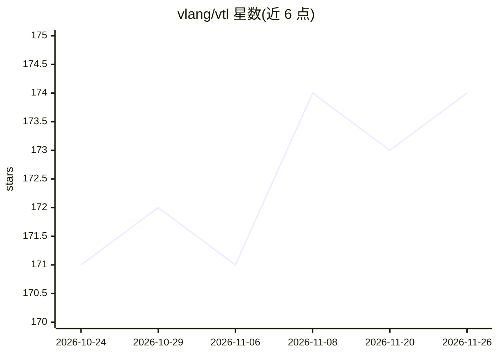

# vlang/vtl

⭐ 174 · V · MIT · 推送 2026-11-25 · [GitHub](https://github.com/vlang/vtl) · [官网](https://vlang.github.io/vtl) · 组织维护

**V 语言的张量库：数值计算与神经网络训练**

VTL 是用 V 编写的张量库，面向数值计算与机器学习：提供 n 维数组、切片/广播/einsum、反向模式自动微分、VSL 支撑的线性代数（矩阵乘、特征分解、QR/SVD 等）、FFT、统计模块以及完整的神经网络模块（Sequential API、Dense/Conv2D/LSTM/Attention 层、多种损失与优化器）。CPU 路径为主，CUDA 与 Vulkan 为可选的实验性加速后端。支持 MNIST、CIFAR-10、IMDB 数据加载，并可读写 NumPy .npy/.npz 与 CSV。通过 v install 安装，MIT 许可。

## 筛选速览

| 维度 | 判定 | 备注 |
|---|---|---|
| AI 角色 | `ai-native` | 本体是模型或模型工具 |
| 许可风险 | `permissive` | MIT |
| 部署形态 | `None` |  |
| 模型依赖 | — | README 未给出锁定关系 |
| 硬件要求 | — | 无带数字的原话,不猜 |
| 安装摩擦 | `medium` | 含编译或系统依赖之一 |
| 成熟度 | `idea` | |

## 能力要点

- 纯 V 实现的张量库，n 维数组与 einsum、复数运算
- 反向模式自动微分，支持任意计算图
- 神经网络模块含 Sequential API、Conv2D/LSTM/Attention 与多种优化器
- VSL 支撑的线性代数（QR、LU、Cholesky、SVD）与 FFT

## 适用场景

- 用 V 语言训练小型神经网络
- 做张量数值计算与线性代数运算
- 实验自动微分与反向传播
- 读写 NumPy 数组与数值 CSV 数据

## 场景标签

`模型训练` · 领域:训练与推理

## 证据(README 行号)

> L20: **VTL** is a pure-V tensor library for numerical computing
> L22: VSL, and a full neural network module.
> L67: - **Neural networks** — `Sequential` API; Linear, Conv2D, LSTM, Attention, …

## 星数曲线

2026-10-24 171 → 2026-11-26 174（+3）

---
*卡片 v1 · prompt 1.4 · 生成 2026-11-26 · 置信度 high · 依据 README sha `7b8f3aa8d081` · [字段定义](../../DATASET.md)*
