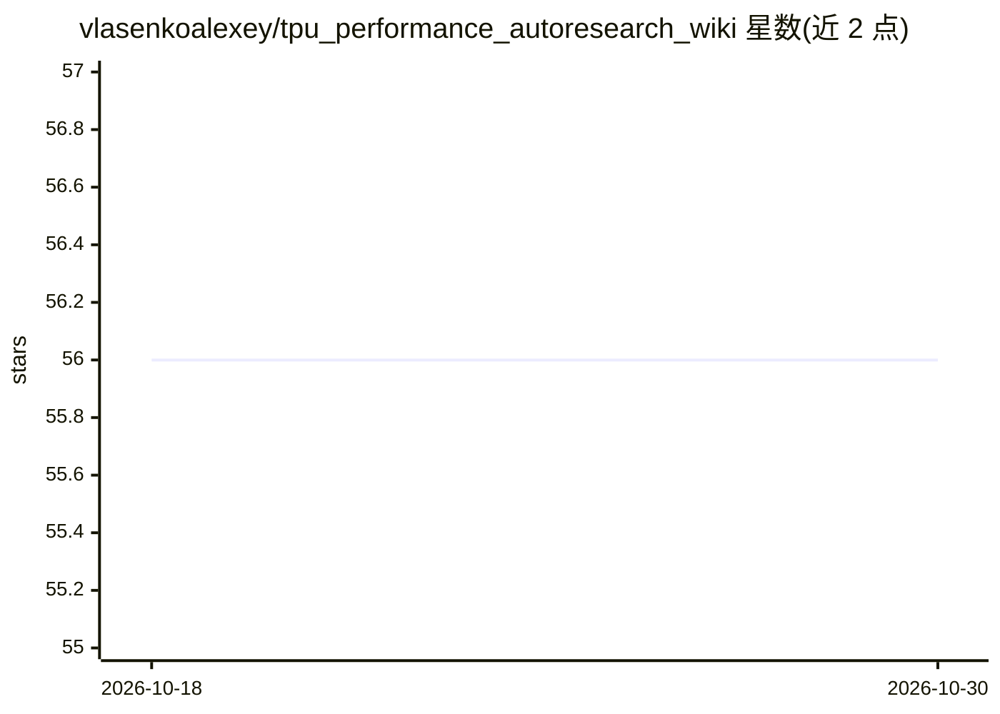

# vlasenkoalexey/tpu_performance_autoresearch_wiki

⭐ 56 · HTML · MIT · 推送 2026-09-04 · [GitHub](https://github.com/vlasenkoalexey/tpu_performance_autoresearch_wiki) · [官网](https://vlasenkoalexey.github.io/tags/autoresearch/) · 个人维护

**TPU 模型性能优化知识库 Wiki，接入 LLM 自主研究引擎**

基于 Karpathy 的 LLM wiki 方法构建的 TPU 性能优化领域知识库：以带 schema 的纯 markdown 文件组织，索引约 200 个来自约 30 个开源仓库的 Pallas kernel，用 grep 检索，供 LLM agent 读取与写入。配套实践为 autoresearch 循环——LLM agent 自主提出假设、打补丁、在真实 TPU 硬件上基准测试与剖析（经 XProf/xprof-cli），并记录实验台账；xprof-cli 为私有仓库，需联系作者获取。适合做 TPU/JAX/PyTorch-XLA 性能调优的开发者与研究者参考。

## 筛选速览

| 维度 | 判定 | 备注 |
|---|---|---|
| AI 角色 | `ai-knowledge` | 知识聚合/清单类 |
| 许可风险 | `permissive` | MIT |
| 部署形态 | `library` | 以包/库形式分发 |
| 模型依赖 | — | README 未给出锁定关系 |
| 硬件要求 | — | 无带数字的原话,不猜 |
| 安装摩擦 | `low` | 无编译、无系统依赖或容器化 |
| 成熟度 | — | 结构信号不足 |

## 能力要点

- markdown wiki + grep 检索的确定性知识库，索引约 200 个 Pallas kernel（约 30 个开源仓库）
- autoresearch 循环：假设→代码 diff→真机基准→剖析→裁决→记录，逐轮复利
- xprof-cli 将 XProf 剖析与 HLO/LLO dump 暴露为 agent 可调用的 CLI 工具（私有仓库）

## 适用场景

- 让 LLM agent 自主迭代 TPU 训练配置与 Pallas kernel 优化
- 查找生态中已有的 Pallas kernel 及其生产可用性
- 研究知识库+自主实验循环的性能优化方法

## 场景标签

`科研工具` `知识库管理` · 领域:知识与检索

## 证据(README 行号)

> L102: ### 🧠 LLM Wiki — collection of domain knowledge on TPU optimization
> L104: Out of the box, an LLM's knowledge of TPU performance is thin — it has a rough sense of FLOPs, attention, and gene
> L106: A lighter alternative, popularized by Karpathy in his **LLM wiki gist**, is to just build a wiki: plain markdown f

## 星数曲线

2026-10-18 56 → 2026-10-30 56（+0）

---
*卡片 v1 · prompt 1.4 · 生成 2026-10-24 · 置信度 mid · 依据 README sha `51880145f0cf` · [字段定义](../../DATASET.md)*
