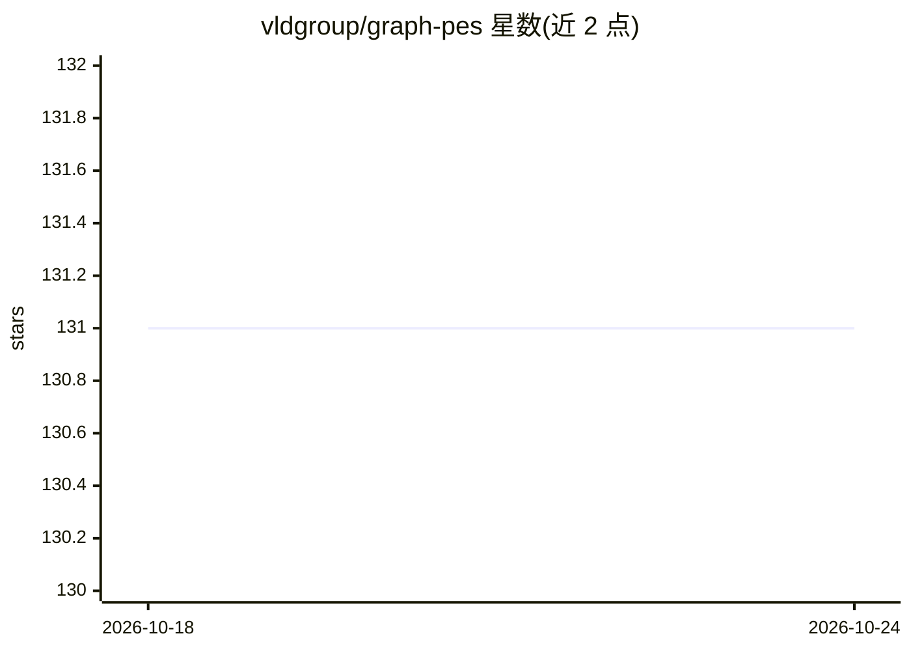

# vldgroup/graph-pes

⭐ 131 · Python · MIT · 推送 2026-09-22 · [GitHub](https://github.com/vldgroup/graph-pes) · [官网](https://vldgroup.github.io/graph-pes/) · 组织维护

**构建、训练与部署机器学习势能面模型的框架**

面向计算化学与材料模拟研究者的机器学习势能面（PES）工具包：支持基于原子结构图表示的模型构建、训练与部署。可通过 graph-pes-train 命令从头训练或微调 SchNet、MACE 等多种架构及 MACE-MP0、MatterSim 等基础模型；训练后可配合 LAMMPS、ASE、torch-sim 进行单点能、结构优化与分子动力学模拟。也提供 GraphPESModel 基类供开发新架构。以 pip 包与 CLI 形式提供，含 Colab 快速上手。

## 筛选速览

| 维度 | 判定 | 备注 |
|---|---|---|
| AI 角色 | `ai-ecosystem` | LLM/agent 周边工具 |
| 许可风险 | `permissive` | MIT |
| 部署形态 | `library` | 以包/库形式分发 |
| 模型依赖 | — | README 未给出锁定关系 |
| 硬件要求 | — | 无带数字的原话,不猜 |
| 安装摩擦 | `low` | 无编译、无系统依赖或容器化 |
| 成熟度 | — | 结构信号不足 |

## 能力要点

- 从头训练或微调多种 MLIP 架构（SchNet、NequIP、PaiNN、MACE、TensorNet 等）
- 统一接口使用/微调基础模型：MACE-MP0、MACE-OFF、MatterSim、GO-MACE、Egret、Orb v2/3
- 训练后模型可配合 LAMMPS、ASE、torch-sim 运行模拟
- GraphPESModel 基类支持实现新架构，CLI 支持分布式训练与调度

## 适用场景

- 用自己的数据训练机器学习势能面模型
- 在 LAMMPS/ASE/torch-sim 中运行 MLIP 驱动的分子动力学
- 微调现有基础模型并做单点能与结构优化计算

## 场景标签

 · 领域:计算化学/材料模拟

## 证据(README 行号)

> L5: `graph-pes` is a framework built to accelerate the development of machine-learned potential energy surface (PES) mod
> L17: `graph-pes` is a toolkit for building, training, and deploying machine-learned potential energy surfaces (PES) mode
> L21: As a researcher wanting to work on MLIP methodology, `graph-pes` makes implementing new architectures easy, allows 

## 星数曲线

2026-10-18 131 → 2026-10-24 131（+0）

---
*卡片 v1 · prompt 1.4 · 生成 2026-10-22 · 置信度 high · 依据 README sha `c3b421b2c799` · [字段定义](../../DATASET.md)*
