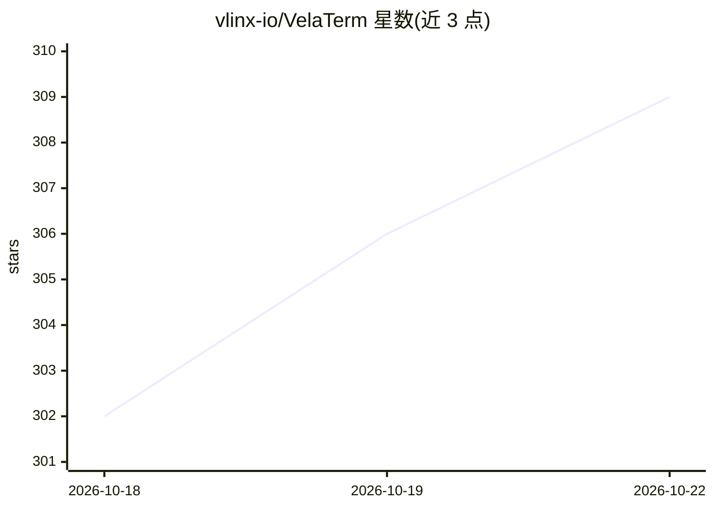

# vlinx-io/VelaTerm

⭐ 312 · TypeScript · MIT · 推送 2026-10-22 · [GitHub](https://github.com/vlinx-io/VelaTerm) · [官网](https://velaterm.com) · 组织维护 · 中文 README

**面向 AI 编程 Agent 的原生开发环境终端（ADE）**

基于 Tauri 2（Rust 后端 + React 19 前端）的原生桌面应用，将编码 Agent（Claude Code、Codex、OpenCode、Copilot、Cursor 等）以受管会话形式运行：会话树组织项目/分组/会话，支持终端分屏、状态通知、配额与 token 监控。提供跨会话命令（vsearch/vrefer/vtell）、Plan/Execute 多会话分工模式、Session 知识库（vkb）与内置代码审计工作流。支持 macOS/Windows/Linux，可经 SSH/HTTPS/手机 App 远程访问同一会话树。MIT 许可，安装包从官网下载。

## 筛选速览

| 维度 | 判定 | 备注 |
|---|---|---|
| AI 角色 | `ai-ecosystem` | LLM/agent 周边工具 |
| 许可风险 | `permissive` | MIT |
| 部署形态 | `library` | 以包/库形式分发 |
| 模型依赖 | — | README 未给出锁定关系 |
| 硬件要求 | — | 无带数字的原话,不猜 |
| 安装摩擦 | `low` | 无编译、无系统依赖或容器化 |
| 成熟度 | — | 结构信号不足 |

## 能力要点

- 多编码 Agent 以受管会话运行，支持实时状态、恢复与自定义启动参数
- vspawn 子会话与 vsearch/vrefer/vtell 跨会话通信命令
- Plan/Execute 模式将大任务拆分给多个 Agent 会话并行执行
- SSH/HTTPS/手机 App 三种方式远程访问同一会话树

## 适用场景

- 在单一窗口中并排管理多个 AI 编程 Agent 会话
- 把大任务拆分给多个 Agent 会话并行开发并汇总评审
- 在手机上查看并回复正在运行的 Agent 会话

## 场景标签

 · 领域:开发者工具/AI 编程

## 证据(README 行号)

> L7: Manage agent sessions like Codex. Split terminals like iTerm2. VelaTerm keeps both in one native app,
> L26: Claude Code, Codex, OpenCode, Copilot, Cursor, Antigravity, Cline, Pi and more. Each one runs as a
> L91: Plan / Execute mode splits a large task across several agent sessions, each with one job. The

## 星数曲线

2026-10-18 302 → 2026-10-22 309（+7）

---
*卡片 v1 · prompt 1.4 · 生成 2026-10-21 · 置信度 high · 依据 README sha `6778aaa0ae1c` · [字段定义](../../DATASET.md)*
