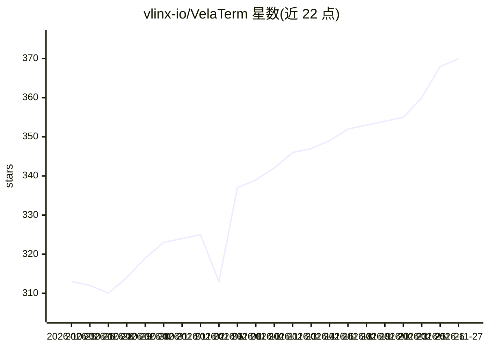

# vlinx-io/VelaTerm

⭐ 370 · Rust · MIT · 推送 2026-11-26 · [GitHub](https://github.com/vlinx-io/VelaTerm) · [官网](https://velaterm.com) · 组织维护

**管理 AI 编码 agent 会话并支持终端分屏的原生应用**

以 Tauri 2 构建的桌面/浏览器/手机端应用，将多种编码 agent（Claude Code、Codex、OpenCode、Copilot、Cursor 等）作为托管会话统一管理，同时提供 iTerm2 式终端分屏。关键机制：会话树组织、真实伪终端后台保活、子会话派生（vspawn）、跨会话检索与消息互通（vsearch/vrefer/vtell）、Plan/Execute 多会话协作、Session Knowledge Base 与本地代码图查询（vkb）。支持 SSH 远程连接与 HTTPS 端到端加密的浏览器/手机访问。安装依赖 Homebrew 或安装包；源码构建需 Node.js、pnpm、Rust 工具链。

## 筛选速览

| 维度 | 判定 | 备注 |
|---|---|---|
| AI 角色 | `ai-ecosystem` | LLM/agent 周边工具 |
| 许可风险 | `permissive` | MIT |
| 部署形态 | `library` | 以包/库形式分发 |
| 模型依赖 | — | README 未给出锁定关系 |
| 硬件要求 | — | 无带数字的原话,不猜 |
| 安装摩擦 | `low` | 无编译、无系统依赖或容器化 |
| 成熟度 | — | 结构信号不足 |

## 能力要点

- 多种编码 agent 以托管会话形式统一管理，带状态跟踪与完成通知
- 跨会话互通：vsearch/vrefer/vtell 支持会话间检索、询问与消息
- Plan/Execute 模式将大任务拆给 planner 与多个 executor 会话并行执行
- 内置远程访问：SSH 连接与 HTTPS 端到端加密的浏览器/手机端接入

## 适用场景

- 在同一窗口管理多个 AI 编码 agent 会话与终端
- 让多个 agent 会话拆分协作完成一个大任务
- 在手机或浏览器上远程查看并回复 agent 会话
- 利用会话知识库让 agent 在行动前先查笔记与代码图

## 场景标签

`编码 Agent` `知识库管理` · 领域:编码与开发

## 证据(README 行号)

> L7: Manage agent sessions like Codex. Split terminals like iTerm2. VelaTerm keeps both in one native app,
> L26: Claude Code, Codex, OpenCode, Copilot, Cursor, Antigravity, Cline, Pi and more. Each one runs as a
> L153: - **Desktop.** Native app for macOS, Windows and Linux. Connect to remote machines over SSH from

## 星数曲线

2026-10-25 313 → 2026-11-27 370（+57）

---
*卡片 v1 · prompt 1.4 · 生成 2026-11-26 · 置信度 mid · 依据 README sha `97fb368e14aa` · [字段定义](../../DATASET.md)*
