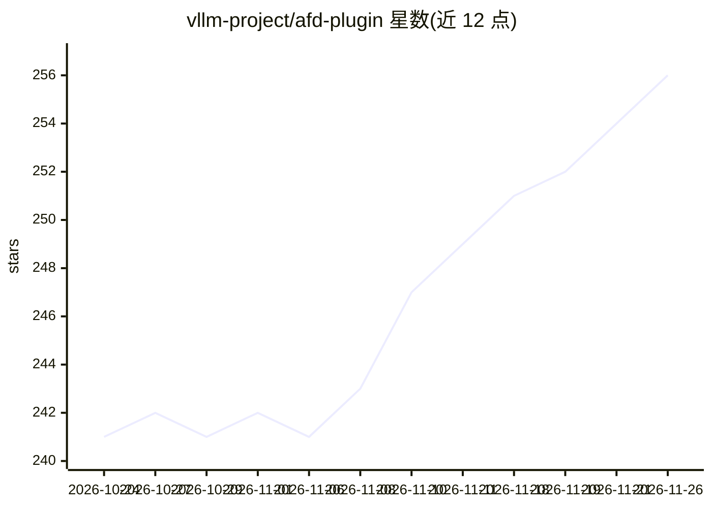

# vllm-project/afd-plugin

⭐ 256 · Python · Apache-2.0 · 推送 2026-11-25 · [GitHub](https://github.com/vllm-project/afd-plugin) · 组织维护

**vLLM 的注意力-FFN 分离插件，面向 GPU/NPU 部署**

afd-plugin 是 vLLM 官方组织下的外部插件，为 Attention-FFN 分离（AFD）架构提供 plugin-owned 的 worker 类、model runner、模型包装器、connector、配置校验、兼容 shim 与硬件门控集成测试，支持 GPU 与昇腾 NPU 部署。通过 vLLM 通用插件入口扩展，不修改 vLLM 源码树。项目自述仍处于实验阶段，需在更多硬件后端做大规模测试；模型与 connector 的适用范围见支持矩阵。

## 筛选速览

| 维度 | 判定 | 备注 |
|---|---|---|
| AI 角色 | `ai-ecosystem` | LLM/agent 周边工具 |
| 许可风险 | `permissive` | Apache-2.0 |
| 部署形态 | `None` |  |
| 模型依赖 | local-ok | 支持本地模型 |
| 硬件要求 | — | 无带数字的原话,不猜 |
| 安装摩擦 | `medium` | 含编译或系统依赖之一 |
| 成熟度 | — | 结构信号不足 |

## 能力要点

- 通过 vLLM 通用插件入口扩展，不修改 vLLM 源码
- 支持 GPU 与 Ascend NPU 两种硬件后端
- 提供 connector 机制分离 Attention 与 FFN 服务
- 提供支持矩阵与已知精度/停机限制说明

## 适用场景

- 在 GPU 集群上部署注意力与 FFN 分离的 vLLM 推理
- 在昇腾 NPU 环境下运行 AFD 部署
- 为 vLLM 开发新的 AFD connector 与后端适配

## 场景标签

`推理引擎` · 领域:训练与推理

## 证据(README 行号)

> L7: **afd-plugin** is a vLLM
> L17: The plugin extends vLLM through its general-plugin entry point without

## 星数曲线

2026-10-24 241 → 2026-11-26 256（+15）

---
*卡片 v1 · prompt 1.4 · 生成 2026-11-25 · 置信度 high · 依据 README sha `b5d708616ff8` · [字段定义](../../DATASET.md)*
