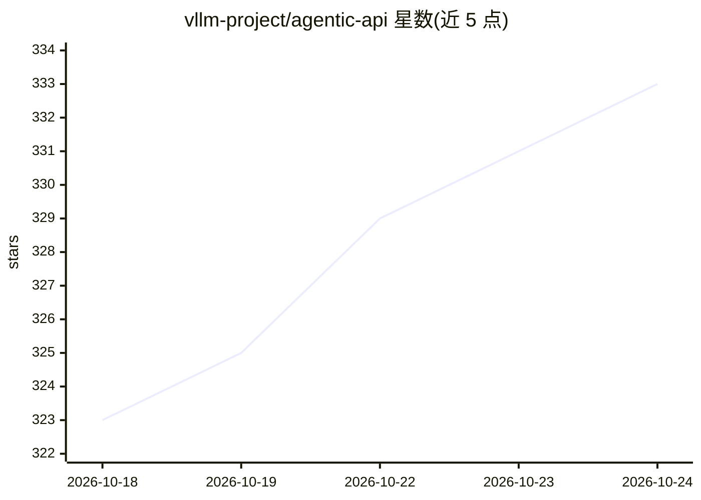

# vllm-project/agentic-api

⭐ 333 · Rust · Apache-2.0 · 推送 2026-10-23 · [GitHub](https://github.com/vllm-project/agentic-api) · [官网](https://vllm-project.github.io/agentic-api/) · 组织维护

**为 vLLM 等推理后端提供有状态 agentic API 的 Rust 网关**

Rust 编写的 API 网关，置于 vLLM 等上游推理服务之前，将 OpenAI Responses API、Anthropic Messages API、服务端工具执行、多轮对话状态与多 agent 编排移到服务端管理。支持 Codex 与 Claude Code 客户端接入、Web 搜索（You.com/Brave/Tavily/Serply/SearXNG）、MCP 工具、上下文压缩与 OpenTelemetry 观测。安装方式含 cargo 构建、PyPI 包与 uv；存储默认 SQLite，可选 PostgreSQL。vLLM 是支持的后端之一而非产品组成部分。

## 筛选速览

| 维度 | 判定 | 备注 |
|---|---|---|
| AI 角色 | `ai-ecosystem` | LLM/agent 周边工具 |
| 许可风险 | `permissive` | Apache-2.0 |
| 部署形态 | `library` | 以包/库形式分发 |
| 模型依赖 | local-ok | 支持本地模型 |
| 硬件要求 | — | 无带数字的原话,不猜 |
| 安装摩擦 | `medium` | 含编译或系统依赖之一 |
| 成熟度 | — | 结构信号不足 |

## 能力要点

- 服务端管理对话状态（previous_response_id / Conversations API）
- 服务端工具执行：Web 搜索、MCP 工具、可选嵌入式代码解释器
- 兼容 Codex 与 Claude Code 流量，支持 HTTP/SSE/WebSocket 传输
- 上下文压缩接口与 OpenTelemetry 观测

## 适用场景

- 让 Codex / Claude Code 完全跑在自有 GPU 的开源模型上
- 在自托管 vLLM 前获得有状态的 Responses / Messages API
- 将工具调用与多轮编排逻辑从客户端迁移到服务端

## 场景标签

`模型网关` `多智能体` · 领域:Agent 开发

## 证据(README 行号)

> L16: **Agentic API moves it server-side.** It is a Rust-native gateway that sits in front of vLLM and owns the stateful 
> L14: vLLM gives you state-of-the-art inference throughput. But real agentic applications need more than raw tokens: they
> L48: |`POST /v1/messages` · `POST /v1/messages/count_tokens`|Anthropic Messages API forwarded to the upstream, with a se

## 星数曲线

2026-10-18 323 → 2026-10-24 333（+10）

---
*卡片 v1 · prompt 1.4 · 生成 2026-10-21 · 置信度 high · 依据 README sha `d7ef2ebbf0bd` · [字段定义](../../DATASET.md)*
